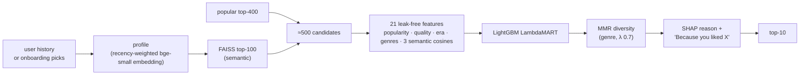

# Semantic Recommendation & Ranking Engine

[](https://github.com/Vanshika-0111/semantic-recsys/actions/workflows/ci.yml)
[](https://semantic-recsys.streamlit.app/)

Two-stage movie recommender: semantic retrieval (Sentence Transformers + FAISS) followed by a
LightGBM LambdaMART ranker, with zero-shot onboarding for brand-new users, diversity re-ranking and
faithful "Because you liked X" explanations — evaluated on MovieLens 32M (+ TMDB metadata) and served
by a FastAPI API behind a Streamlit UI.

**▶ Live demo: <https://semantic-recsys.streamlit.app/>** — pick a few movies you like (or describe
what you're in the mood for) and the list updates live. Free hosting: if the app has been idle it
takes about a minute to wake up.

## Results at a glance

All numbers are on held-out **test** data that no choice was tuned on (every setting was picked on
validation first), with paired-bootstrap 95% CIs over users. Generated, not hand-copied:
[`reports/results/summary.md`](reports/results/summary.md).

| what | result |
|---|---|
| **Warm users** (189,197 test users), NDCG@10 | popularity **0.0501 → 0.0866 (+72.7%)**, p ≈ 0 · vs release-aware popularity **+55%** · vs TF-IDF content baseline ×4.9 |
| What semantic embeddings add (ablation) | same ranker with no embeddings anywhere: 0.0698 → **+24.1%** with them |
| **Cold-start users** (5,000 users never in training) | **+27.2%** NDCG@10 over popularity with 5 onboarding picks, **+17.1%** with 3 (both p < 0.001) |
| Zero-shot, no ranker training | embedding re-rank of popular movies from the user's picks: +5.7% at 5 picks (p = 0.005) |
| Two-stage retrieval | stage 1 = popular top-400 ∪ FAISS top-100 → 87% of users have a liked movie among 500 candidates; stage 2 = LambdaMART on 21 leak-free features |
| Diversity (MMR, λ chosen on validation) | **+12.7% genres** per top-10 and +10.7% intra-list diversity for −1.4% NDCG@10 |
| Explanations | removing the cited "you liked X" movie drops the recommendation **25.7 ranks** vs 0.6 for a random other like |
| Serving | API answer = evaluation code (golden check 200/200); **~45 ms p50 / ~75 ms p95** per full request (ranker + MMR + explanations) on a laptop CPU |
| Engineering | one-command reproducible pipeline, frozen fingerprinted split, 208 tests, CI builds and smoke-tests both Docker images |

Full benchmark (NDCG / Recall / Precision / MRR @ 5, 10, 20 vs popularity, release-aware popularity,
TF-IDF, embeddings and ablations): [`reports/results/day10_final.md`](reports/results/day10_final.md).

| | |
|---|---|
|  |  |
|  |  |

## How it works



1. **Item embeddings** — each movie's title, year, genres, keywords and overview → `bge-small-en-v1.5`
   (384-d), mean-centered (fixes embedding anisotropy: ×3 NDCG for the content model).
2. **User profile** — weighted average of liked movies' vectors, half-life of 5 likes (recency: +16%).
3. **Stage 1** — popular top-400 ∪ FAISS top-100 by profile similarity (exact Flat index; HNSW is
   3–5× faster for ~4% recall loss, benchmarked but not needed at 23k movies).
4. **Stage 2** — LambdaMART ranks the candidates using features computed only from the training period.
5. **New users** — 0 picks: popularity · 1–2 picks: a ranker trained on simulated new users ·
   3+ picks: the main ranker (policy chosen on validation). Free text: semantic search mode.
6. **Diversity + explanations** — MMR over the ranker's top-50; TreeSHAP decides the reason shown.

## Honest limitations

- Popularity is a very strong baseline on MovieLens; content-only models (TF-IDF, embeddings) reach
  only ~35% of it. The gain comes from combining semantics with popularity/metadata in the ranker.
- Part of the warm gain is "don't recommend movies released after the user stopped rating"; the
  release-aware popularity baseline (+55%) and a no-year-features ablation (−9%) quantify it.
- Per-user time split: other users' later ratings are in the training data (standard on MovieLens).
- Recommendations skew towards Hollywood (MovieLens users are mostly US-based); text onboarding gives
  on-topic lists but did not improve accuracy, so it is presented as a UX feature only.
- Latencies are from a laptop CPU and vary run to run; the free demo host is slower.

## Quickstart — reproduce everything with one command

```bash
python -m venv .venv && source .venv/bin/activate   # Windows: .venv\Scripts\activate
pip install -r requirements.txt
pip install -e .                                     # the src/recsys package
python scripts/run_pipeline.py --dry-run             # what would run
python scripts/run_pipeline.py                       # download -> ... -> cold start -> summary
pytest -q
```

`run_pipeline.py` runs each step's script in order and **skips a step whose outputs already exist**,
so re-running costs seconds. The frozen split is never rebuilt — it is re-verified (SHA-256
fingerprint) on every run and the pipeline stops if it changed. Each run writes
`reports/results/pipeline_manifest.json` (git commit, OS, Python + package versions, split
fingerprint, seconds per step) and regenerates `reports/results/summary.md`, which also checks that
every results file was computed on the same split. Useful flags: `--smoke` (quick check),
`--from retrieval --force` (redo a step and everything after it), `--steps baselines --force`.

From nothing, on an 8 GB CPU laptop: about 2 h, mostly encoding the 23k movie documents twice
(Day 4, cached afterwards); with data and vectors in place, all experiments take ~30 min.
A step counts as done only if its results file matches the current split *and* its cached files in
`data/` exist, so on a fresh clone (results committed, `data/` empty) every step re-runs.

| step | script | what it does |
|---|---|---|
| download | `download_data.py` | MovieLens 32M + Kaggle TMDB dump (needs a Kaggle API token) |
| prepare | `prepare_data.py` | join + k-core filter → `data/processed/` |
| eda | `eda.py` | figures + `reports/eda_summary.md` |
| split | `make_split.py` | Day 2: create + freeze the evaluation split (`--verify` afterwards) |
| baselines | `run_baselines.py` | Day 3: popularity + TF-IDF |
| embeddings | `run_embeddings.py` | Day 4: MiniLM vs bge-small + FAISS Flat |
| retrieval | `run_retrieval.py` | Day 5: warm profiles, candidate recall, Flat vs HNSW |
| coldstart | `run_coldstart.py` | Day 6: cold-start onboarding (seeds / text) |
| candidates | `run_candidates.py` | Day 8: stage-1 union (popular ∪ FAISS) + leak-free ranker features |
| ranker | `run_ranker.py` | Day 9: LightGBM LambdaMART ranker on validation (+ cold mode) |
| final | `run_final.py` | Day 10: final test table, ablations, real cold users, SHAP |
| diversity | `run_diversity.py` | Day 11: MMR diversity re-ranking + "Because you liked X" explanations |
| serving | `run_serving.py` | Day 12: API bundle, golden check (API == evaluation code), p50/p95 latency |
| summary | `summarize_results.py` | one page of headline numbers from all days |

Every script also runs on its own and has `--smoke` and `--stages …`.

## Repo layout

```
src/recsys/      library code: config, data, split, metrics, text, baselines, embeddings, ann,
                 candidates, features, ranker, coldstart, evaluation, diversity, explain,
                 serving (bundle + Engine), api (FastAPI), client (HTTP client for the UI), hub (Hugging
                 Face publish/deploy), synthetic (small synthetic world for tests + CI),
                 experiment (shared script plumbing), summary
app/             Streamlit UI (talks to the API: over HTTP, or the same FastAPI app in-process on the public demo)
deploy/          API + UI in one Docker container (CI-tested; deployable as a Hugging Face Docker Space)
.github/         CI: pytest + Docker builds of the API and demo images with a synthetic bundle
scripts/         runnable pipeline steps + run_pipeline.py; upload_bundle / deploy_space (Day 13)
tests/           unit tests (expected values hand-computed in comments)
reports/         EDA summary, figures, results/ (json + markdown per day, summary.md, manifest)
data/            raw + processed data, caches, logs (git-ignored)
```

## Data decisions

- Items are joined to TMDB on `tmdbId` from `links.csv`, falling back to the IMDb id.
- Movies without a TMDB overview are dropped (the model is text-based).
- Iterative k-core: every user and item keeps >= 20 ratings after filtering.
- `items.parquet` holds metadata only; popularity / average-rating features are computed
  later from the training split to avoid leakage.

## Evaluation protocol (frozen on Day 2)

- **Warm users** — per user, ratings ordered by (timestamp, movieId):
  last 10 → **test**; the 10 before → **validation** (only if ≥ 10 training ratings remain);
  the rest → **train**. Tuning: fit on train, score on val. Final numbers: fit on train + val, score on test.
- **Cold-start users** — 5,000 users (seeded sample) removed from *all* training data.
  Their first 5 liked movies are onboarding seeds; models are scored on their last 10 ratings
  with 0 / 1 / 3 / 5 seeds.
- **Relevance**: rating ≥ 4. Users with no relevant held-out item are skipped.
- **Metrics** (`src/recsys/metrics.py`, hand-checked in `tests/test_metrics.py`):
  NDCG@K, Recall@K, Precision@K, MRR@K, hit rate, catalog coverage, long-tail share,
  intra-list diversity, at K = 5 / 10 / 20.
- The split is fingerprinted (SHA-256 of user, item, split) in
  `data/processed/splits/split_manifest.json`; `python scripts/make_split.py --verify` proves
  every model used the same split.
- Known limitation: a per-user time split is not a global time split, so some training
  ratings of other users are later than a user's test ratings (standard for MovieLens; noted).

## Baselines (Day 3)

Both baselines share one scoring path (dense batch scores → remove already-rated movies →
top-K), so every later model is compared under identical rules.

- **Popularity** — rank movies by number of training ratings (`count`) or by number of
  ratings ≥ 4 (`liked`); the variant is picked on validation.
- **TF-IDF content-based (item-kNN)** — TF-IDF (1–2-grams) over the *same* item document the
  embedding model uses on Day 4 (title, year, genres, keywords, tagline, overview). Each movie
  keeps its 200 most cosine-similar movies; a user's score for movie *j* is
  Σᵢ w(u,i)·sim(i,j) over their history. With all neighbours kept this ranks exactly like
  cosine(user TF-IDF centroid, movie) (unit-tested); keeping 200 makes it fast and gives
  "because you liked X" explanations for free. Weights: `liked` (1 for rating ≥ 4) or
  `centered` (rating − user mean, so dislikes push similar movies down), optionally only the
  last 50 items; chosen on validation.
- Cold start: profiles come from the 1 / 3 / 5 onboarding seeds; with 0 seeds the content
  model has nothing to go on and falls back to popularity.
- Beyond accuracy: catalog coverage, long-tail share (outside the top 10% most-rated movies)
  and genre intra-list diversity @10.

Results: `reports/results/day03_baselines.md`.

## Semantic item embeddings (Day 4)

- The same item document as TF-IDF is encoded by two small sentence encoders:
  `all-MiniLM-L6-v2` (6 layers) and `bge-small-en-v1.5` (12 layers, retrieval-tuned), both 384-d.
  Vectors are L2-normalised, so a dot product is a cosine similarity. bge's query instruction
  prefix is used only for short text queries (cold-start onboarding), never for documents.
- Vectors are cached in `data/embeddings/` together with a SHA-256 of the documents, so a change
  to the document template can never silently reuse stale vectors.
- **FAISS `IndexFlatIP`** = exact nearest-neighbour search (every item is compared). It is the
  ground truth for the approximate HNSW index (Day 5) and the candidate generator (Day 8).
  A unit test checks it returns exactly the brute-force numpy top-K.
- **Embedding recommender**: profile = normalised sum of the user's history vectors, with the
  same weights as TF-IDF (`liked` / `centered`, all or last 50); score = cosine(profile, movie);
  same tie-break, seen-item masking and top-K as every other model. Encoder and profile setting
  are chosen on validation only.

Results: `reports/results/day04_embeddings.md`, examples: `reports/results/day04_similar_movies.md`.

## Warm-user profiles, retrieval and HNSW (Day 5)

- Profile weights: `graded` (4★ → 1, 5★ → 2) with a recency half-life of 5 liked movies
  (positions, not days — most users rate in bulk sessions). Chosen on validation: +16% NDCG@10 on test
  over the Day 4 profile.
- Stage-1 retrieval is judged by recall@N. Popularity retrieves more relevant movies than embeddings
  (recall@200 0.36 vs 0.11), but the two top-200 lists overlap only 3.5% → Day 8 uses their union.
- FAISS HNSW vs exact Flat on real user-profile queries: ~4× lower p95 latency at recall ≈ 0.96.

Results: `reports/results/day05_retrieval.md`, chart `reports/figures/day05_retrieval_flat_vs_hnsw.png`.

## Cold start (Day 6)

- New users give 1–5 onboarding picks and/or free text. Pool = the 20 most-liked movies, re-ranked by
  cos(profile, movie) + λ·popularity; pool and λ tuned on *pseudo-cold* validation users, never on the
  cold test users.
- +5.7% NDCG@10 over popularity with 5 picks (paired bootstrap p = 0.005, 5,000 users never in
  training). Free text adds no measurable accuracy, so it powers a separate semantic "explore" mode.

Results: `reports/results/day06_coldstart.md`, chart `reports/figures/day06_cold_start_ndcg_vs_seeds.png`.

## Reproducibility (Day 7)

- One frozen split (fingerprinted), one seed (`config.SEED`), settings chosen on validation and read
  by later days from the earlier days' json (`recsys.experiment.chosen_settings`).
- Shared script code lives in `src/recsys/experiment.py` (tested); scripts never import each other.
- The Day 7 refactor was checked by running every script before and after the change on the same data
  and comparing all result files and per-user metrics: identical (only latency timings differ).

## Stage-1 candidates + ranker features (Day 8)

- Stage 1 = popular top-N ∪ FAISS top-M (exact Flat search with the Day 5 profile, already-rated
  movies removed). Day 5 showed a fixed split of 200 always loses recall to popularity, but the two
  lists barely overlap, so the union is measured on an N × M grid on validation and the best union
  with FAISS in it (≤ 500 candidates) goes to the ranker. Popularity-only at the same size is
  reported next to it — Day 9 tests both end to end.
- `src/recsys/features.py`: 21 features per (user, candidate) — source ranks, item popularity /
  Bayesian average rating / recent popularity, static metadata (year, runtime, genres), user
  activity, and user–item similarity (cos to the recent and long-term profile, max-cos to any of
  the last 50 liked movies, genre affinity, year and popularity gaps).
- No leakage: every feature comes from one history table (train to predict val, train+val to
  predict test). TMDB vote counts / popularity are not used (the dump is from after the ratings).
  Checks: sorting by `pop_rank` reproduces the popularity baseline exactly; each feature alone is
  scored as a ranker; the oracle shows the ceiling of the candidate set.
- Results: `reports/results/day08_candidates.md`; Day 9 input `data/runs/day08_features_val.parquet`.

## Stage-2 ranker (Day 9)

- `src/recsys/ranker.py`: LightGBM LambdaMART (`objective=lambdarank`) — trees whose gradients come
  from how much swapping two movies changes NDCG. One query = one user's candidate list.
- Labels from the val window (features from train): binary (rating ≥ 4) or graded (4★/4.5★/5★ with
  gains 1/1.5/2 = the project's graded NDCG). The 20k feature users are split once by user into
  ranker-train (75%) / ranker-valid (25%); early stopping and every choice use ranker-valid only.
- The Day 8 open question is settled end to end: the ranker is trained on **both** candidate sets —
  the union (popular 400 ∪ FAISS 100) and popular-500 with FAISS kept only as a feature — and the
  better val NDCG@10 wins. Metrics count every relevant val movie, including those stage 1 missed.
- `TwoStage` = the serving path (history → candidates → features → scores → top-k) used by Day 10
  and the API; a check confirms it rebuilds the Day 8 training features identically.
- Cold mode: the same features for pseudo-cold users (only their first 1/3/5 liked movies), compared
  with popularity, the Day 6 semantic rerank and the warm ranker applied as is.
- Results: `reports/results/day09_ranker.md`, chart `reports/figures/day09_ranker_val.png`;
  models `data/runs/day09_ranker.txt`, `data/runs/day09_cold_ranker.txt` (git-ignored).

## Final evaluation (Day 10)

Test is used once, here; every setting was chosen on validation.

- **Warm users:** the Day 9 ranker (trained on val labels) with stage 1 + features fit on train+val,
  scored on all warm test users at K = 5/10/20 against popularity, a **release-date-aware
  popularity** (only movies released by the year of the user's last training rating — the per-user
  split otherwise lets popularity recommend movies a user could not have seen), TF-IDF and the
  embedding recommender. Paired bootstrap for every comparison.
- **Ablations** (retrained on the Day 9 split + config): without the 5 semantic features; without
  any semantics (popular-500 candidates + no semantic features); without release-year features.
- **Real cold-start users:** popularity, Day 6 semantic rerank, cold ranker, warm ranker, and the
  policy chosen on pseudo-cold validation (0 picks → popularity, 1–2 → cold ranker, ≥ 3 → warm).
- **SHAP:** exact TreeSHAP from LightGBM (`pred_contrib`) on 1,000 test users' candidates, per
  feature and per group, plus worked "why this movie" examples.
- Results: `reports/results/day10_final.md`; charts `reports/figures/day10_*.png`; the headline
  numbers and CV-bullet status are in `reports/results/summary.md`.

## Diversity + explanations (Day 11)

- **MMR re-ranking** (`src/recsys/diversity.py`): the ranker's top-50 is re-ordered greedily by
  λ·relevance − (1−λ)·(max similarity to the movies already picked); λ = 1 is the ranker unchanged.
  Two similarity spaces (bge embeddings, genres) × λ grid. λ is chosen on validation by a rule fixed
  before the run (most diverse setting within 2% of the ranker's NDCG@10), then measured once on
  test with paired bootstraps on accuracy AND diversity (genre + semantic intra-list diversity,
  genres per list, coverage). `TwoStage.recommend(..., mmr={"lambda", "pool", "space"})` serves it.
- **Explanations** (`src/recsys/explain.py`): the cited movie X is the user's recent like with the
  highest cosine to the recommendation — exactly the ranker feature `max_cos_liked`; TreeSHAP picks
  which reason to show (similar movie / genres / era / popular / highly rated).
  **Faithfulness check:** remove X from the history and re-score, vs removing a random other recent like.
- Results: `reports/results/day11_diversity.md`, `day11_examples.md`; chart
  `reports/figures/day11_mmr_tradeoff.png`.

## API (Day 12)

```bash
python scripts/run_serving.py              # validation check, bundle -> data/serving, golden check, latency
uvicorn recsys.api:app --port 8000         # then open http://localhost:8000/docs
```

| endpoint | what it does |
|---|---|
| `GET /recommend/{user_id}` | a demo user (1,000 warm test users ship in the bundle): popular 400 ∪ FAISS 100 → 21 features → LambdaMART → genre MMR λ 0.7 → reason + "Because you liked X" |
| `POST /recommend/history` | any user's own ratings (oldest first) |
| `POST /recommend/cold-start` | onboarding: 0 picks → popularity, 1–2 → cold ranker, ≥ 3 → warm ranker (Day 10 policy); text only → explore mode (semantic search over the 1,000 most-liked movies) |
| `GET /movies/search`, `/movies/{id}`, `/movies/{id}/similar`, `/users/demo`, `/users/{id}/history`, `/health` | helpers for the UI |

- **Bundle, not ratings:** `run_serving.py` (stage `bundle`) saves everything the recommender needs that
  comes from ratings — item statistics, popularity, the cold-start prior — plus item vectors, both
  rankers and the validated settings (~50 MB). The API starts in seconds and never touches the 31M ratings.
- **Golden check:** the API engine, built only from the bundle, returns the same top-10 as the code that
  produced the evaluation numbers, for warm users (with and without MMR) and real cold users at 1/3/5 picks.
- **Release filter:** Day 10 saw "ranker + release filter" +2.8% on test but it had never been checked on
  validation; `run_serving.py` checks it on validation with a rule fixed beforehand and the bundle
  stores the decision.
- **Latency:** p50/p95/p99 per endpoint, one request at a time (in-process, or `--url` for a running
  server / container), plus a per-step breakdown. Results: `reports/results/day12_serving.md`.
- **Docker:** `docker build -t semantic-recsys-api .` then `docker run -p 8000:8000 semantic-recsys-api`
  (needs `data/serving` built first; `--build-arg WITH_TEXT=false` for a small image without free-text search).

## UI, CI and public demo (Day 13)

```bash
uvicorn recsys.api:app --port 8000          # terminal 1: the API
streamlit run app/streamlit_app.py          # terminal 2: the UI -> http://localhost:8501
```

- **UI** (`app/streamlit_app.py`): pick movies (popular grid, title search or a sample taste) and the
  list updates live — 1–2 picks use the cold-start ranker, 3+ the full ranker; posters, the SHAP reason
  and "Because you liked X" as a second line; free-text explore mode; similar movies; and, with the
  local bundle, demo users with ✓ on recommendations they really liked later. The UI only talks HTTP to
  the API, so what it shows is what the golden-checked API returns.
- **CI** (`.github/workflows/ci.yml`): pytest (incl. an end-to-end UI test: Streamlit AppTest → real
  uvicorn server → Engine), then both Docker images are built and started with a small **synthetic
  bundle** (`scripts/make_synthetic_bundle.py`: 80 movies, real LightGBM rankers) and probed over HTTP.
- **Public demo** (Streamlit Community Cloud, free): `scripts/upload_bundle.py` publishes the serving
  bundle to a Hugging Face model repo **without any user's ratings** (MovieLens licence). The demo runs
  `app/streamlit_app.py` with its own small `app/requirements.txt` (CPU-only torch); with no API server
  next to it, the UI starts the **same FastAPI app in-process** (same routes, validation and Engine) and
  downloads the bundle from Hugging Face on first start. `scripts/check_public_bundle.py` runs that exact
  path on the laptop. The UI picks its API automatically: `RECSYS_API_URL` → that server; a server on
  localhost:8000 → that one; otherwise in-process.
- **Container deployment** (`deploy/hf_space/`): one Docker image running the API + UI, built and
  smoke-tested by CI on every push; `scripts/deploy_space.py` deploys it as a Hugging Face Docker Space
  (needs Hugging Face PRO since mid-2026).

## Data attribution

MovieLens: F. Maxwell Harper and Joseph A. Konstan. 2015. The MovieLens Datasets:
History and Context. ACM TiiS 5, 4. This product uses TMDB data and images but is not endorsed
or certified by TMDB. No MovieLens ratings are redistributed: the public demo bundle
holds item-level aggregates and trained models only.
