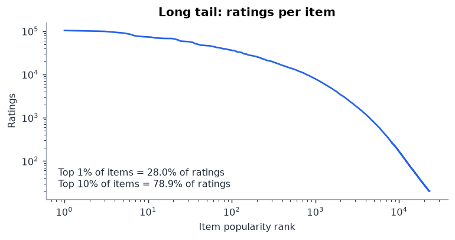
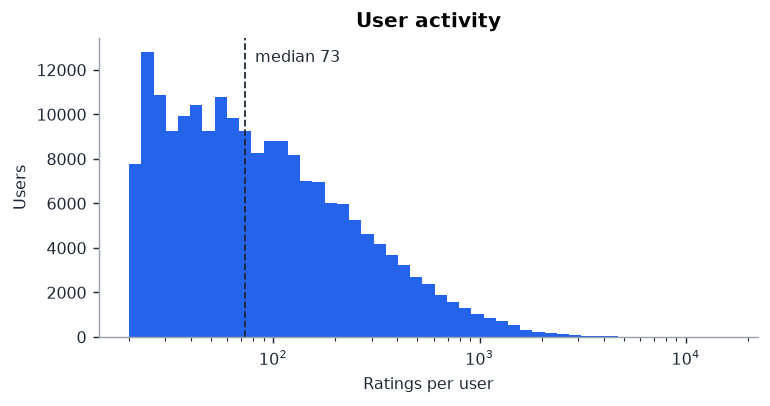
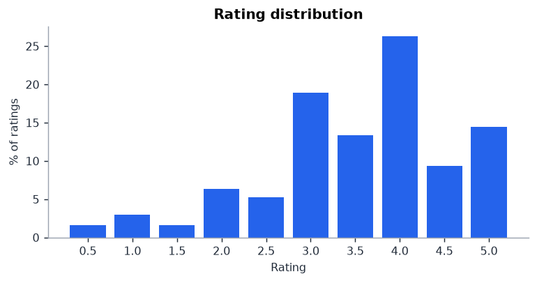
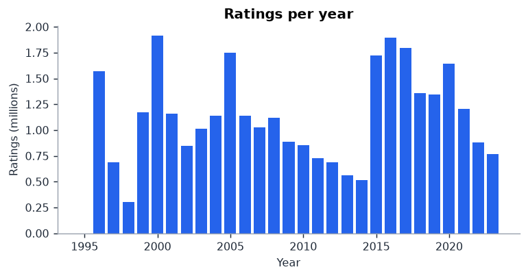
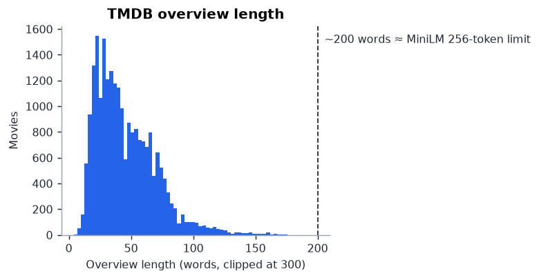
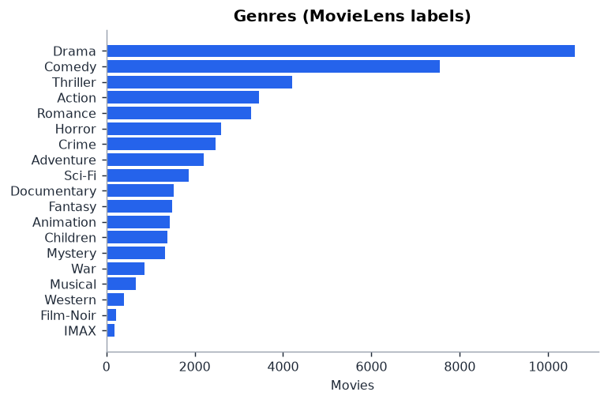

# Day 1 EDA summary

## Data funnel

| Stage | Ratings | Users | Items |
|---|---:|---:|---:|
| Raw MovieLens 32M | 32,000,204 | 200,948 | 84,432 |
| Items with TMDB overview | 31,943,737 | 200,948 | 83,327 |
| k-core (>= 20 per user & item) | 31,668,426 | 200,690 | 23,109 |

Kept 98.96% of ratings; density 0.6828%; k-core converged in 3 iterations.
TMDB join: {'match_source_counts': {'tmdbId': 83095, 'none': 867, 'imdbId': 470}, 'items_with_overview_pct': 98.69, 'ratings_on_items_with_overview_pct': 99.82, 'items_with_poster_pct': 97.73}

## Key numbers

```json
{
  "ratings_per_user": {
    "min": 20,
    "median": 73,
    "p90": 362,
    "max": 16005
  },
  "ratings_per_item": {
    "min": 20,
    "median": 113,
    "p90": 2799,
    "max": 102851
  },
  "top1pct_items_share": 28.0,
  "top10pct_items_share": 78.9,
  "mean_rating": 3.545,
  "pct_ratings_ge_4": 50.0,
  "time_range": "1995-01-09 to 2023-10-13",
  "users_single_day_pct": 58.8,
  "median_user_span_days": 0.1,
  "split_boundary_tie_pct": 16.4,
  "test_on_items_lt5_train_ratings_pct": 0.0,
  "test_items_unseen_in_train_pct": 0.0,
  "overview_words": {
    "median": 40,
    "p95": 90,
    "pct_over_200": 0.0
  },
  "items_with_keywords_pct": 92.6
}
```

## What this means for the next days

- **Popularity is strong** (top 1% of items = 28.0% of ratings): the popularity baseline will be hard to beat on NDCG — report coverage/diversity too.
- **58.8% of users rated everything within one day**: recency decay in Day 5 profiles will matter little for them; check before tuning it.
- **16.4% of users have a timestamp tie at the train/test boundary**: break ties deterministically (timestamp, then movieId) in the Day 2 split.
- **0.0% of held-out ratings are on items unseen in train** (0.0% on items with < 5 train ratings): this is where content embeddings can beat popularity.
- **Overviews: median 40 words, 0.0% over 200**: MiniLM truncation is a non-issue.

## Figures







