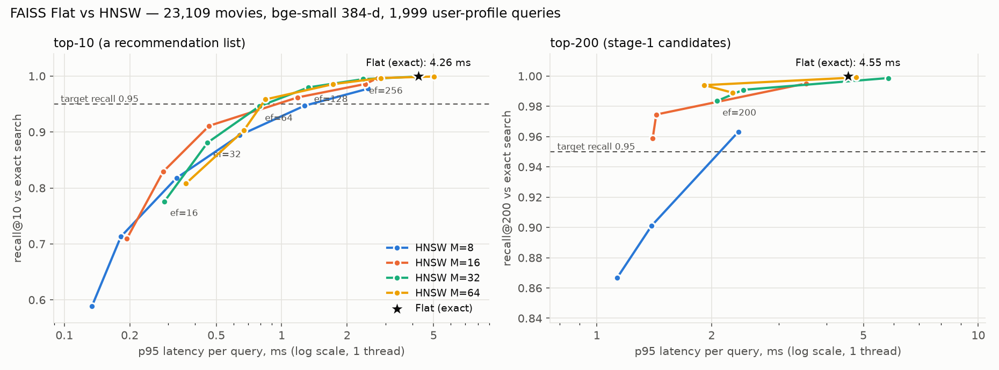

# Day 5 — Warm-user profiles, retrieval, Flat vs HNSW

Split fingerprint `a99079d4a40a…`. Encoder `bge-small`, mean-centered vectors (Day 4 choice). Relevant = rating ≥ 4.

## Test — fit on train+val, 189,197 users

| model | config | ndcg@5 | ndcg@10 | ndcg@20 | recall@10 | precision@10 | mrr@10 | hit_rate@10 |
|---|---|---:|---:|---:|---:|---:|---:|---:|
| bge-small (day4 profile) | weights=liked, half-life=none | 0.0134 | 0.0146 | 0.0190 | 0.0161 | 0.0097 | 0.0330 | 0.0854 |
| bge-small (day5 profile) | weights=graded, half-life=5 | 0.0163 | 0.0169 | 0.0208 | 0.0175 | 0.0107 | 0.0388 | 0.0901 |
| popularity (Day 3) | mode=liked | 0.0461 | 0.0501 | 0.0674 | 0.0548 | 0.0345 | 0.1013 | 0.2351 |
| tfidf_knn (Day 3) | weighting=liked, history=50 | 0.0176 | 0.0178 | 0.0215 | 0.0181 | 0.0111 | 0.0410 | 0.0913 |

| model | coverage@10 | long_tail@10 | diversity@10 | ms_per_user |
|---|---:|---:|---:|---:|
| bge-small (day4 profile) | 0.7635 | 0.5601 | 0.4857 | 0.4001 |
| bge-small (day5 profile) | 0.9101 | 0.6375 | 0.4941 | 0.3896 |
| popularity (Day 3) | 0.0166 | 0.0000 | 0.7135 | 0.3895 |
| tfidf_knn (Day 3) | 0.6248 | 0.5922 | 0.5645 | 0.6412 |

## Profile tuning — validation, 30,000 users (same sample as Days 3–4)

| model | config | ndcg@10 | recall@10 | mrr@10 | coverage@10 | long_tail@10 | diversity@10 |
|---|---|---:|---:|---:|---:|---:|---:|
| popularity | mode=liked | 0.0485 | 0.0543 | 0.0961 | 0.0117 | 0.0000 | 0.7084 |
| bge-small | weights=liked, half-life=none | 0.0145 | 0.0158 | 0.0334 | 0.4699 | 0.5565 | 0.4838 |
| bge-small | weights=liked, half-life=3 | 0.0160 | 0.0166 | 0.0372 | 0.7585 | 0.6571 | 0.5009 |
| bge-small | weights=liked, half-life=5 | 0.0164 | 0.0173 | 0.0378 | 0.6858 | 0.6274 | 0.4938 |
| bge-small | weights=liked, half-life=10 | 0.0163 | 0.0175 | 0.0375 | 0.5938 | 0.5983 | 0.4882 |
| bge-small | weights=liked, half-life=25 | 0.0155 | 0.0169 | 0.0352 | 0.5160 | 0.5754 | 0.4853 |
| bge-small | weights=liked, half-life=50 | 0.0151 | 0.0164 | 0.0342 | 0.4891 | 0.5662 | 0.4844 |
| bge-small | weights=liked, half-life=100 | 0.0148 | 0.0161 | 0.0338 | 0.4790 | 0.5616 | 0.4843 |
| bge-small | weights=graded, half-life=none | 0.0148 | 0.0160 | 0.0344 | 0.4802 | 0.5624 | 0.4850 |
| bge-small | weights=graded, half-life=3 | 0.0162 | 0.0167 | 0.0376 | 0.7661 | 0.6636 | 0.5004 |
| bge-small | weights=graded, half-life=5 | 0.0168 | 0.0176 | 0.0387 | 0.6973 | 0.6345 | 0.4946 |
| bge-small | weights=graded, half-life=10 | 0.0167 | 0.0179 | 0.0379 | 0.6053 | 0.6054 | 0.4889 |
| bge-small | weights=graded, half-life=25 | 0.0159 | 0.0174 | 0.0360 | 0.5262 | 0.5825 | 0.4856 |
| bge-small | weights=graded, half-life=50 | 0.0155 | 0.0169 | 0.0356 | 0.5013 | 0.5740 | 0.4852 |
| bge-small | weights=graded, half-life=100 | 0.0152 | 0.0163 | 0.0350 | 0.4878 | 0.5687 | 0.4854 |

Day 4 (liked, no decay) on validation: 0.01447. Selected: `{"model": "bge-small", "center": true, "weighting": "graded", "half_life": 5}`. Examples: `day05_retrieval_examples.md`.

## Stage-1 retrieval — validation, 30,000 users

| retriever | recall@50 | recall@100 | recall@200 | recall@500 | hit_rate@50 | hit_rate@100 | hit_rate@200 | hit_rate@500 |
|---:|---:|---:|---:|---:|---:|---:|---:|---:|
| bge-small (weights=graded, half-life=5) | 0.0460 | 0.0705 | 0.1069 | 0.1841 | 0.2108 | 0.2997 | 0.4126 | 0.5881 |
| popularity (liked) | 0.1680 | 0.2497 | 0.3608 | 0.5475 | 0.4785 | 0.5999 | 0.7233 | 0.8557 |

Mixed candidate sets of 200 (embedding top-a, then popular movies not already in):

| from_embeddings | from_popularity | recall@200 | hit_rate@200 | avg_unique |
|---:|---:|---:|---:|---:|
| 200 | 0 | 0.1069 | 0.4126 | 200.0000 |
| 150 | 50 | 0.2470 | 0.6564 | 200.0000 |
| 100 | 100 | 0.3062 | 0.7077 | 200.0000 |
| 50 | 150 | 0.3423 | 0.7294 | 200.0000 |
| 0 | 200 | 0.3608 | 0.7233 | 200.0000 |

Overlap: 3.5% of the embedding top-200 is also in the popularity top-200.

## FAISS Flat vs HNSW — 23,109 × 384-d, 1,999 user-profile queries (latency: 1,000 single queries, 1 thread)

| index | M | ef_search | k | recall | p50_ms | p95_ms | build_s | size_mb |
|---:|---:|---:|---:|---:|---:|---:|---:|---:|
| Flat |  |  | 10 | 1.0000 | 3.0300 | 4.2570 | 0.0000 | 35.5000 |
| Flat |  |  | 200 | 1.0000 | 2.9630 | 4.5550 | 0.0000 | 35.5000 |
| HNSW | 8 | 16 | 10 | 0.5887 | 0.0880 | 0.1340 | 4.7000 | 37.4000 |
| HNSW | 8 | 32 | 10 | 0.7129 | 0.1170 | 0.1820 | 4.7000 | 37.4000 |
| HNSW | 8 | 64 | 10 | 0.8177 | 0.2050 | 0.3280 | 4.7000 | 37.4000 |
| HNSW | 8 | 128 | 10 | 0.8942 | 0.4340 | 0.6410 | 4.7000 | 37.4000 |
| HNSW | 8 | 256 | 10 | 0.9471 | 0.6870 | 1.2760 | 4.7000 | 37.4000 |
| HNSW | 8 | 512 | 10 | 0.9774 | 1.4660 | 2.4960 | 4.7000 | 37.4000 |
| HNSW | 8 | 200 | 200 | 0.8669 | 0.5620 | 1.1320 | 4.7000 | 37.4000 |
| HNSW | 8 | 256 | 200 | 0.9011 | 0.7260 | 1.3920 | 4.7000 | 37.4000 |
| HNSW | 8 | 512 | 200 | 0.9631 | 1.4980 | 2.3490 | 4.7000 | 37.4000 |
| HNSW | 16 | 16 | 10 | 0.7094 | 0.1470 | 0.1940 | 8.0000 | 38.8000 |
| HNSW | 16 | 32 | 10 | 0.8291 | 0.2290 | 0.2850 | 8.0000 | 38.8000 |
| HNSW | 16 | 64 | 10 | 0.9111 | 0.3820 | 0.4640 | 8.0000 | 38.8000 |
| HNSW | 16 | 128 | 10 | 0.9618 | 0.7080 | 1.1840 | 8.0000 | 38.8000 |
| HNSW | 16 | 256 | 10 | 0.9858 | 1.2940 | 2.4250 | 8.0000 | 38.8000 |
| HNSW | 16 | 512 | 10 | 0.9962 | 2.2360 | 2.7560 | 8.0000 | 38.8000 |
| HNSW | 16 | 200 | 200 | 0.9587 | 1.0120 | 1.4010 | 8.0000 | 38.8000 |
| HNSW | 16 | 256 | 200 | 0.9746 | 1.1200 | 1.4320 | 8.0000 | 38.8000 |
| HNSW | 16 | 512 | 200 | 0.9951 | 2.0530 | 3.5350 | 8.0000 | 38.8000 |
| HNSW | 32 | 16 | 10 | 0.7760 | 0.1970 | 0.2890 | 9.6000 | 41.8000 |
| HNSW | 32 | 32 | 10 | 0.8810 | 0.2760 | 0.4560 | 9.6000 | 41.8000 |
| HNSW | 32 | 64 | 10 | 0.9459 | 0.4520 | 0.7890 | 9.6000 | 41.8000 |
| HNSW | 32 | 128 | 10 | 0.9797 | 0.8060 | 1.3270 | 9.6000 | 41.8000 |
| HNSW | 32 | 256 | 10 | 0.9946 | 1.4830 | 2.3750 | 9.6000 | 41.8000 |
| HNSW | 32 | 512 | 10 | 0.9989 | 2.4660 | 4.1280 | 9.6000 | 41.8000 |
| HNSW | 32 | 200 | 200 | 0.9835 | 1.2470 | 2.0650 | 9.6000 | 41.8000 |
| HNSW | 32 | 256 | 200 | 0.9909 | 1.4490 | 2.4190 | 9.6000 | 41.8000 |
| HNSW | 32 | 512 | 200 | 0.9987 | 2.8150 | 5.8140 | 9.6000 | 41.8000 |
| HNSW | 64 | 16 | 10 | 0.8081 | 0.2280 | 0.3630 | 12.3000 | 47.7000 |
| HNSW | 64 | 32 | 10 | 0.9026 | 0.3380 | 0.6690 | 12.3000 | 47.7000 |
| HNSW | 64 | 64 | 10 | 0.9582 | 0.5670 | 0.8410 | 12.3000 | 47.7000 |
| HNSW | 64 | 128 | 10 | 0.9855 | 1.0840 | 1.7210 | 12.3000 | 47.7000 |
| HNSW | 64 | 256 | 10 | 0.9965 | 1.7650 | 2.8570 | 12.3000 | 47.7000 |
| HNSW | 64 | 512 | 10 | 0.9992 | 3.5970 | 5.0080 | 12.3000 | 47.7000 |
| HNSW | 64 | 200 | 200 | 0.9890 | 1.4080 | 2.2700 | 12.3000 | 47.7000 |
| HNSW | 64 | 256 | 200 | 0.9940 | 1.4370 | 1.9140 | 12.3000 | 47.7000 |
| HNSW | 64 | 512 | 200 | 0.9991 | 2.7810 | 4.7910 | 12.3000 | 47.7000 |

Operating point top-10 (fastest with recall ≥ 0.95): M=64, ef_search=64 → recall 0.958, p95 0.841 ms, 5.1× faster than Flat.
Operating point top-200 (fastest with recall ≥ 0.95): M=16, ef_search=200 → recall 0.959, p95 1.401 ms, 3.3× faster than Flat.

efConstruction 200, faiss 1.15.1.
