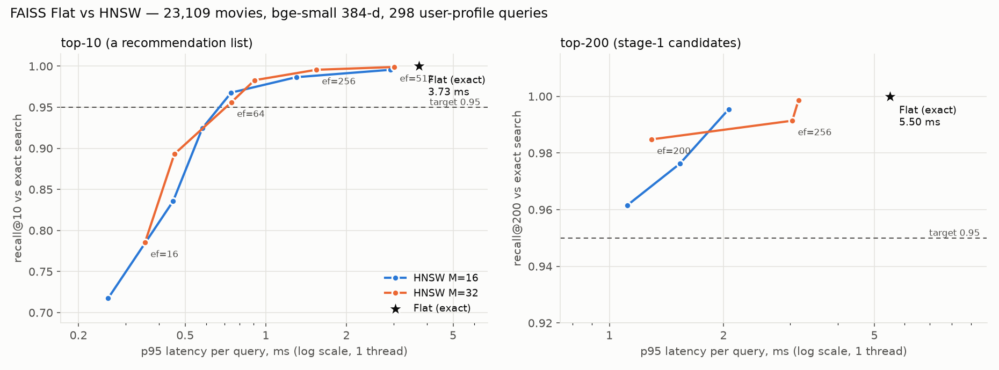

# Day 5 — Warm-user profiles, retrieval, Flat vs HNSW

Split fingerprint `a99079d4a40a…`. Encoder `bge-small`, mean-centered vectors (Day 4 choice). Relevant = rating ≥ 4.

## Test — fit on train+val, 5,000 users

| model | config | ndcg@5 | ndcg@10 | ndcg@20 | recall@10 | precision@10 | mrr@10 | hit_rate@10 |
|---|---|---:|---:|---:|---:|---:|---:|---:|
| bge-small (day4 profile) | weights=liked, half-life=none | 0.0147 | 0.0156 | 0.0197 | 0.0166 | 0.0102 | 0.0359 | 0.0886 |
| bge-small (day5 profile) | weights=liked, half-life=10 | 0.0170 | 0.0176 | 0.0222 | 0.0180 | 0.0112 | 0.0420 | 0.0974 |
| popularity (Day 3) | mode=liked | 0.0461 | 0.0501 | 0.0674 | 0.0548 | 0.0345 | 0.1013 | 0.2351 |
| tfidf_knn (Day 3) | weighting=liked, history=50 | 0.0176 | 0.0178 | 0.0215 | 0.0181 | 0.0111 | 0.0410 | 0.0913 |

| model | coverage@10 | long_tail@10 | diversity@10 | ms_per_user |
|---|---:|---:|---:|---:|
| bge-small (day4 profile) | 0.2643 | 0.5593 | 0.4850 | 0.5516 |
| bge-small (day5 profile) | 0.3390 | 0.6025 | 0.4899 | 0.3065 |
| popularity (Day 3) | 0.0166 | 0.0000 | 0.7135 | 0.1610 |
| tfidf_knn (Day 3) | 0.6248 | 0.5922 | 0.5645 | 0.2597 |

## Profile tuning — validation, 3,000 users (same sample as Days 3–4)

| model | config | ndcg@10 | recall@10 | mrr@10 | coverage@10 | long_tail@10 | diversity@10 |
|---|---|---:|---:|---:|---:|---:|---:|
| popularity | mode=liked | 0.0504 | 0.0565 | 0.0996 | 0.0059 | 0.0000 | 0.7102 |
| bge-small | weights=liked, half-life=none | 0.0157 | 0.0170 | 0.0345 | 0.2013 | 0.5455 | 0.4857 |
| bge-small | weights=liked, half-life=10 | 0.0170 | 0.0182 | 0.0378 | 0.2652 | 0.5887 | 0.4890 |
| bge-small | weights=liked, half-life=25 | 0.0165 | 0.0177 | 0.0370 | 0.2281 | 0.5662 | 0.4876 |
| bge-small | weights=liked, half-life=50 | 0.0159 | 0.0171 | 0.0358 | 0.2145 | 0.5585 | 0.4871 |
| bge-small | weights=liked, half-life=100 | 0.0158 | 0.0172 | 0.0352 | 0.2077 | 0.5541 | 0.4869 |
| bge-small | weights=graded, half-life=none | 0.0156 | 0.0170 | 0.0346 | 0.2071 | 0.5573 | 0.4864 |
| bge-small | weights=graded, half-life=10 | 0.0167 | 0.0183 | 0.0374 | 0.2718 | 0.5943 | 0.4894 |
| bge-small | weights=graded, half-life=25 | 0.0165 | 0.0188 | 0.0356 | 0.2347 | 0.5718 | 0.4880 |
| bge-small | weights=graded, half-life=50 | 0.0157 | 0.0173 | 0.0349 | 0.2212 | 0.5665 | 0.4870 |
| bge-small | weights=graded, half-life=100 | 0.0155 | 0.0170 | 0.0348 | 0.2135 | 0.5626 | 0.4854 |

Day 4 (liked, no decay) on validation: 0.01447. Selected: `{"model": "bge-small", "center": true, "weighting": "liked", "half_life": 10}`. Examples: `day05_retrieval_smoke_examples.md`.

## Stage-1 retrieval — validation, 3,000 users

| retriever | recall@50 | recall@100 | recall@200 | recall@500 | hit_rate@50 | hit_rate@100 | hit_rate@200 | hit_rate@500 |
|---:|---:|---:|---:|---:|---:|---:|---:|---:|
| bge-small (weights=liked, half-life=10) | 0.0505 | 0.0783 | 0.1191 | 0.2026 | 0.2193 | 0.3213 | 0.4350 | 0.6143 |
| popularity (liked) | 0.1699 | 0.2498 | 0.3605 | 0.5491 | 0.4837 | 0.6070 | 0.7293 | 0.8617 |

Mixed candidate sets of 200 (embedding top-a, then popular movies not already in):

| from_embeddings | from_popularity | recall@200 | hit_rate@200 | avg_unique |
|---:|---:|---:|---:|---:|
| 200 | 0 | 0.1191 | 0.4350 | 200.0000 |
| 150 | 50 | 0.2580 | 0.6733 | 200.0000 |
| 100 | 100 | 0.3118 | 0.7183 | 200.0000 |
| 50 | 150 | 0.3427 | 0.7340 | 200.0000 |
| 0 | 200 | 0.3605 | 0.7293 | 200.0000 |

Overlap: 4.1% of the embedding top-200 is also in the popularity top-200.

## FAISS Flat vs HNSW — 23,109 × 384-d, 298 user-profile queries (latency: 200 single queries, 1 thread)

| index | M | ef_search | k | recall | p50_ms | p95_ms | build_s | size_mb |
|---:|---:|---:|---:|---:|---:|---:|---:|---:|
| Flat |  |  | 10 | 1.0000 | 2.3080 | 3.7340 | 0.0000 | 35.5000 |
| Flat |  |  | 200 | 1.0000 | 2.2530 | 5.5020 | 0.0000 | 35.5000 |
| HNSW | 16 | 16 | 10 | 0.7174 | 0.1460 | 0.2580 | 9.4000 | 38.8000 |
| HNSW | 16 | 32 | 10 | 0.8356 | 0.2300 | 0.4510 | 9.4000 | 38.8000 |
| HNSW | 16 | 64 | 10 | 0.9245 | 0.3020 | 0.5800 | 9.4000 | 38.8000 |
| HNSW | 16 | 128 | 10 | 0.9678 | 0.5610 | 0.7430 | 9.4000 | 38.8000 |
| HNSW | 16 | 256 | 10 | 0.9866 | 0.9450 | 1.3010 | 9.4000 | 38.8000 |
| HNSW | 16 | 512 | 10 | 0.9956 | 1.6680 | 2.9230 | 9.4000 | 38.8000 |
| HNSW | 16 | 200 | 200 | 0.9615 | 0.7280 | 1.1140 | 9.4000 | 38.8000 |
| HNSW | 16 | 256 | 200 | 0.9762 | 0.9620 | 1.5340 | 9.4000 | 38.8000 |
| HNSW | 16 | 512 | 200 | 0.9954 | 1.5650 | 2.0630 | 9.4000 | 38.8000 |
| HNSW | 32 | 16 | 10 | 0.7852 | 0.2190 | 0.3540 | 10.3000 | 41.8000 |
| HNSW | 32 | 32 | 10 | 0.8930 | 0.3180 | 0.4560 | 10.3000 | 41.8000 |
| HNSW | 32 | 64 | 10 | 0.9560 | 0.4660 | 0.7440 | 10.3000 | 41.8000 |
| HNSW | 32 | 128 | 10 | 0.9829 | 0.7590 | 0.9080 | 10.3000 | 41.8000 |
| HNSW | 32 | 256 | 10 | 0.9956 | 1.2530 | 1.5440 | 10.3000 | 41.8000 |
| HNSW | 32 | 512 | 10 | 0.9990 | 2.1940 | 3.0150 | 10.3000 | 41.8000 |
| HNSW | 32 | 200 | 200 | 0.9848 | 1.0960 | 1.2910 | 10.3000 | 41.8000 |
| HNSW | 32 | 256 | 200 | 0.9914 | 1.5960 | 3.0370 | 10.3000 | 41.8000 |
| HNSW | 32 | 512 | 200 | 0.9987 | 2.3400 | 3.1550 | 10.3000 | 41.8000 |

Operating point top-10 (fastest with recall ≥ 0.95): M=16, ef_search=128 → recall 0.968, p95 0.743 ms, 5.0× faster than Flat.
Operating point top-200 (fastest with recall ≥ 0.95): M=16, ef_search=200 → recall 0.962, p95 1.114 ms, 4.9× faster than Flat.

efConstruction 200, faiss 1.15.1.
