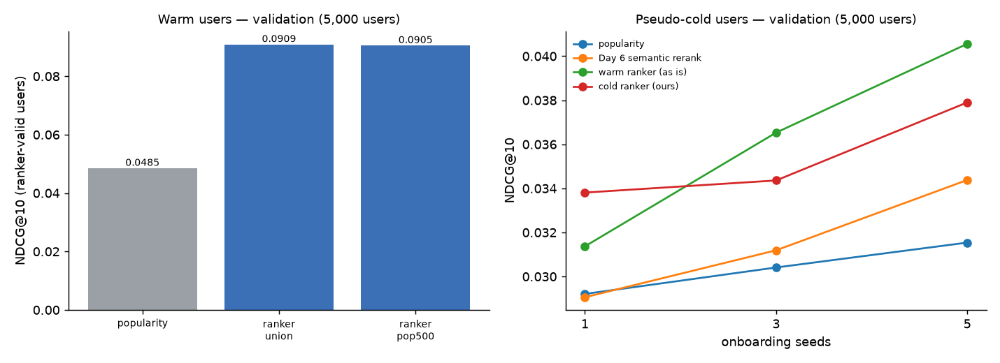

# Day 9 — LightGBM LambdaMART ranker (validation)

Split fingerprint `a99079d4a40a…`. Features = Day 8 (history = train), labels = val ratings. The 20k feature users are split once by user into ranker-train / ranker-valid; every number here is on ranker-valid users and is computed over their FULL val ratings (a relevant movie stage 1 missed counts as a miss). Test is untouched (Day 10).

**Selected for Day 10:** popular 400 ∪ FAISS 100, graded labels, 127 leaves, 83 trees (`data\runs\day09_ranker.txt`) — highest ranker-valid NDCG@10 over (candidate set x grid); tie -> union.

## Warm users — 5,000 ranker-valid users (trees fit on 15,000 others)

| model | config | ndcg@5 | ndcg@10 | ndcg@20 | recall@10 | precision@10 | mrr@10 | hit_rate@10 | oracle@10 |
|---|---|---:|---:|---:|---:|---:|---:|---:|---:|
| popularity | Day 3 baseline, same users | 0.0439 | 0.0485 | 0.0661 | 0.0544 | 0.0334 | 0.0942 | 0.2254 |  |
| LightGBM ranker — popular 400 ∪ FAISS 100 | graded labels, 127 leaves | 0.0833 | 0.0909 | 0.1145 | 0.1001 | 0.0591 | 0.1765 | 0.3818 | 0.6181 |
| LightGBM ranker — popular 500 (FAISS top-100 as feature) | binary labels, 127 leaves | 0.0832 | 0.0905 | 0.1140 | 0.0985 | 0.0589 | 0.1745 | 0.3750 | 0.6257 |

Paired bootstrap (resampling users, NDCG@10):

| model | vs | change | 95% CI of diff | p_le_0 |
|---|---|---:|---:|---:|
| ranker (union) | popularity | +87.4% | [+0.0383, +0.0465] | 0.0000 |
| ranker (pop500) | popularity | +86.6% | [+0.0379, +0.0461] | 0.0000 |
| ranker (union) | ranker (pop500) | +0.4% | [-0.0019, +0.0025] | 0.3750 |

### Grid (early stopping on ranker-valid)

| candidates | config | best_iter | ndcg@10 | recall@10 | mrr@10 | lgb_valid_ndcg@10 | seconds |
|---|---|---:|---:|---:|---:|---:|---:|
| union | binary labels, 31 leaves | 87 | 0.0904 | 0.0980 | 0.1738 | 0.2497 | 86.9000 |
| union | binary labels, 127 leaves | 106 | 0.0903 | 0.0984 | 0.1754 | 0.2503 | 123.5000 |
| union | graded labels, 31 leaves | 118 | 0.0901 | 0.0979 | 0.1746 | 0.2480 | 95.8000 |
| union | graded labels, 127 leaves | 83 | 0.0909 | 0.1001 | 0.1765 | 0.2490 | 95.6000 |
| pop500 | binary labels, 31 leaves | 160 | 0.0898 | 0.0979 | 0.1730 | 0.2556 | 110.8000 |
| pop500 | binary labels, 127 leaves | 98 | 0.0905 | 0.0985 | 0.1745 | 0.2565 | 105.7000 |
| pop500 | graded labels, 31 leaves | 156 | 0.0898 | 0.0970 | 0.1734 | 0.2545 | 114.2000 |
| pop500 | graded labels, 127 leaves | 54 | 0.0894 | 0.0965 | 0.1721 | 0.2535 | 86.9000 |

`lgb_valid_ndcg@10` = LightGBM's own metric: candidates only, and a user with no relevant candidate counts as 1 — use it for early stopping only.

### Gain importance — union

| feature | gain_share | splits |
|---|---:|---:|
| pop_gap | 0.1204 | 838 |
| year_gap | 0.1042 | 1,026 |
| pop_rank | 0.0953 | 559 |
| cos_longterm | 0.0879 | 619 |
| cos_profile | 0.0851 | 631 |
| max_cos_liked | 0.0776 | 610 |
| user_n_ratings_log | 0.0628 | 870 |
| item_liked_log | 0.0532 | 356 |
| item_year | 0.0531 | 662 |
| item_trend | 0.0379 | 571 |
| genre_affinity | 0.0377 | 543 |
| item_count_log | 0.0300 | 347 |
| item_recent_log | 0.0291 | 408 |
| item_runtime | 0.0258 | 457 |
| item_avg_rating | 0.0236 | 390 |
| user_liked_share | 0.0225 | 490 |
| user_mean_rating | 0.0216 | 483 |
| item_liked_share | 0.0186 | 321 |
| faiss_rank | 0.0135 | 273 |
| in_faiss | 0.0002 | 4 |
| in_pop | 0.0000 | 0 |

### Gain importance — pop500

| feature | gain_share | splits |
|---|---:|---:|
| pop_rank | 0.1204 | 695 |
| cos_profile | 0.1087 | 659 |
| year_gap | 0.1050 | 1,043 |
| cos_longterm | 0.0922 | 720 |
| max_cos_liked | 0.0684 | 862 |
| user_n_ratings_log | 0.0659 | 985 |
| pop_gap | 0.0642 | 985 |
| item_year | 0.0550 | 704 |
| genre_affinity | 0.0462 | 816 |
| item_recent_log | 0.0398 | 559 |
| item_liked_log | 0.0395 | 367 |
| item_trend | 0.0332 | 519 |
| item_runtime | 0.0279 | 558 |
| user_liked_share | 0.0273 | 684 |
| item_count_log | 0.0262 | 447 |
| user_mean_rating | 0.0244 | 613 |
| item_avg_rating | 0.0228 | 470 |
| item_liked_share | 0.0184 | 352 |
| faiss_rank | 0.0142 | 305 |
| in_faiss | 0.0002 | 5 |
| in_pop | 0.0000 | 0 |

## Feature tables

TwoStage (the Day 10 / API path) rebuilds the Day 8 union features identically ✓ (max |diff| 0.0e+00).

| variant | candidates | rows | relevant_rows | file |
|---|---|---:|---:|---|
| pop500 | popular 500 (FAISS top-100 as feature) | 10,000,000 | 66,501 | data\runs\day09_features_val_pop500.parquet |
| union | popular 400 ∪ FAISS 100 | 9,854,146 | 64,946 | data\runs\day08_features_val.parquet |

## Cold mode — 5,000 pseudo-cold validation users

Cold ranker: graded labels, 127 leaves, 63 trees, trained on 15,000 other pseudo-cold users. pseudo-cold validation: warm val users shown only their first n liked train movies; history for item statistics = train.

| seeds | model | config | ndcg@5 | ndcg@10 | ndcg@20 | recall@10 | precision@10 | mrr@10 | hit_rate@10 |
|---:|---|---|---:|---:|---:|---:|---:|---:|---:|
| 1 | popularity |  | 0.0246 | 0.0292 | 0.0430 | 0.0344 | 0.0219 | 0.0581 | 0.1608 |
| 1 | Day 6 semantic rerank | pool 20, λ 2.0 | 0.0239 | 0.0291 | 0.0430 | 0.0344 | 0.0218 | 0.0561 | 0.1620 |
| 1 | warm ranker (as is) |  | 0.0267 | 0.0314 | 0.0428 | 0.0365 | 0.0228 | 0.0613 | 0.1688 |
| 1 | cold ranker (ours) |  | 0.0283 | 0.0338 | 0.0471 | 0.0401 | 0.0234 | 0.0663 | 0.1804 |
| 3 | popularity |  | 0.0260 | 0.0304 | 0.0445 | 0.0355 | 0.0225 | 0.0608 | 0.1640 |
| 3 | Day 6 semantic rerank | pool 20, λ 5.0 | 0.0263 | 0.0312 | 0.0450 | 0.0367 | 0.0232 | 0.0599 | 0.1680 |
| 3 | warm ranker (as is) |  | 0.0303 | 0.0365 | 0.0508 | 0.0437 | 0.0270 | 0.0674 | 0.1926 |
| 3 | cold ranker (ours) |  | 0.0293 | 0.0344 | 0.0493 | 0.0400 | 0.0245 | 0.0689 | 0.1874 |
| 5 | popularity |  | 0.0270 | 0.0315 | 0.0456 | 0.0369 | 0.0233 | 0.0625 | 0.1674 |
| 5 | Day 6 semantic rerank | pool 20, λ 5.0 | 0.0293 | 0.0344 | 0.0471 | 0.0405 | 0.0252 | 0.0657 | 0.1794 |
| 5 | warm ranker (as is) |  | 0.0345 | 0.0406 | 0.0556 | 0.0473 | 0.0291 | 0.0768 | 0.2030 |
| 5 | cold ranker (ours) |  | 0.0320 | 0.0379 | 0.0530 | 0.0446 | 0.0267 | 0.0748 | 0.2028 |

| seeds | model | vs | change | 95% CI of diff | p_le_0 |
|---:|---|---|---:|---:|---:|
| 1 | cold ranker (ours) | popularity | +15.8% | [+0.0019, +0.0073] | 0.0000 |
| 1 | cold ranker (ours) | Day 6 semantic rerank | +16.3% | [+0.0022, +0.0073] | 0.0010 |
| 1 | warm ranker (as is) | popularity | +7.4% | [-0.0001, +0.0044] | 0.0290 |
| 3 | cold ranker (ours) | popularity | +13.0% | [+0.0014, +0.0065] | 0.0000 |
| 3 | cold ranker (ours) | Day 6 semantic rerank | +10.2% | [+0.0008, +0.0058] | 0.0040 |
| 3 | warm ranker (as is) | popularity | +20.2% | [+0.0039, +0.0084] | 0.0000 |
| 5 | cold ranker (ours) | popularity | +20.2% | [+0.0034, +0.0090] | 0.0000 |
| 5 | cold ranker (ours) | Day 6 semantic rerank | +10.2% | [+0.0007, +0.0060] | 0.0070 |
| 5 | warm ranker (as is) | popularity | +28.6% | [+0.0064, +0.0115] | 0.0000 |

### Gain importance — cold ranker

| feature | gain_share | splits |
|---|---:|---:|
| pop_gap | 0.1252 | 1,060 |
| cos_longterm | 0.1059 | 652 |
| item_count_log | 0.1006 | 333 |
| year_gap | 0.0976 | 779 |
| pop_rank | 0.0658 | 408 |
| max_cos_liked | 0.0649 | 711 |
| item_recent_log | 0.0644 | 338 |
| cos_profile | 0.0550 | 600 |
| item_year | 0.0506 | 419 |
| genre_affinity | 0.0430 | 455 |

