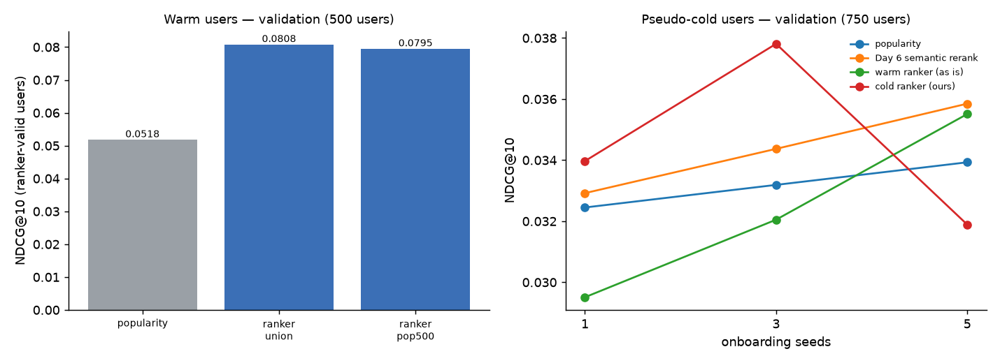

# Day 9 — LightGBM LambdaMART ranker (validation)

Split fingerprint `a99079d4a40a…`. Features = Day 8 (history = train), labels = val ratings. The 20k feature users are split once by user into ranker-train / ranker-valid; every number here is on ranker-valid users and is computed over their FULL val ratings (a relevant movie stage 1 missed counts as a miss). Test is untouched (Day 10).

**Selected for Day 10:** popular 400 ∪ FAISS 100, graded labels, 31 leaves, 61 trees (`data\runs\day09_ranker_smoke.txt`) — highest ranker-valid NDCG@10 over (candidate set x grid); tie -> union.

## Warm users — 500 ranker-valid users (trees fit on 1,500 others)

| model | config | ndcg@5 | ndcg@10 | ndcg@20 | recall@10 | precision@10 | mrr@10 | hit_rate@10 | oracle@10 |
|---|---|---:|---:|---:|---:|---:|---:|---:|---:|
| popularity | Day 3 baseline, same users | 0.0457 | 0.0518 | 0.0717 | 0.0587 | 0.0354 | 0.0966 | 0.2340 |  |
| LightGBM ranker — popular 400 ∪ FAISS 100 | graded labels, 31 leaves | 0.0673 | 0.0808 | 0.1033 | 0.0962 | 0.0550 | 0.1455 | 0.3840 | 0.6282 |
| LightGBM ranker — popular 500 (FAISS top-100 as feature) | binary labels, 31 leaves | 0.0705 | 0.0795 | 0.1035 | 0.0893 | 0.0512 | 0.1590 | 0.3660 | 0.6431 |

Paired bootstrap (resampling users, NDCG@10):

| model | vs | change | 95% CI of diff | p_le_0 |
|---|---|---:|---:|---:|
| ranker (union) | popularity | +55.9% | [+0.0174, +0.0414] | 0.0000 |
| ranker (pop500) | popularity | +53.4% | [+0.0153, +0.0400] | 0.0000 |
| ranker (union) | ranker (pop500) | +1.6% | [-0.0063, +0.0095] | 0.3660 |

### Grid (early stopping on ranker-valid)

| candidates | config | best_iter | ndcg@10 | recall@10 | mrr@10 | lgb_valid_ndcg@10 | seconds |
|---|---|---:|---:|---:|---:|---:|---:|
| union | binary labels, 31 leaves | 22 | 0.0747 | 0.0824 | 0.1447 | 0.2109 | 5.4000 |
| union | graded labels, 31 leaves | 61 | 0.0808 | 0.0962 | 0.1455 | 0.2148 | 7.2000 |
| pop500 | binary labels, 31 leaves | 59 | 0.0795 | 0.0893 | 0.1590 | 0.2196 | 8.4000 |
| pop500 | graded labels, 31 leaves | 61 | 0.0759 | 0.0889 | 0.1425 | 0.2114 | 9.1000 |

`lgb_valid_ndcg@10` = LightGBM's own metric: candidates only, and a user with no relevant candidate counts as 1 — use it for early stopping only.

### Gain importance — union

| feature | gain_share | splits |
|---|---:|---:|
| pop_gap | 0.1104 | 151 |
| cos_longterm | 0.1072 | 117 |
| year_gap | 0.1042 | 215 |
| pop_rank | 0.0986 | 105 |
| cos_profile | 0.0910 | 134 |
| max_cos_liked | 0.0643 | 119 |
| user_n_ratings_log | 0.0563 | 137 |
| genre_affinity | 0.0493 | 114 |
| item_year | 0.0472 | 100 |
| item_liked_log | 0.0455 | 54 |
| item_trend | 0.0444 | 111 |
| item_recent_log | 0.0380 | 67 |
| user_liked_share | 0.0267 | 68 |
| item_count_log | 0.0254 | 64 |
| item_runtime | 0.0252 | 76 |
| user_mean_rating | 0.0212 | 67 |
| item_avg_rating | 0.0157 | 42 |
| faiss_rank | 0.0156 | 48 |
| item_liked_share | 0.0138 | 41 |
| in_pop | 0.0000 | 0 |
| in_faiss | 0.0000 | 0 |

### Gain importance — pop500

| feature | gain_share | splits |
|---|---:|---:|
| cos_longterm | 0.1243 | 105 |
| pop_rank | 0.1181 | 88 |
| year_gap | 0.1056 | 179 |
| cos_profile | 0.0923 | 117 |
| pop_gap | 0.0739 | 147 |
| max_cos_liked | 0.0572 | 120 |
| user_n_ratings_log | 0.0555 | 129 |
| genre_affinity | 0.0515 | 116 |
| item_year | 0.0505 | 125 |
| item_liked_log | 0.0491 | 72 |
| item_trend | 0.0381 | 89 |
| item_recent_log | 0.0332 | 76 |
| item_count_log | 0.0307 | 69 |
| item_runtime | 0.0287 | 79 |
| user_liked_share | 0.0266 | 71 |
| user_mean_rating | 0.0244 | 75 |
| item_avg_rating | 0.0150 | 44 |
| faiss_rank | 0.0142 | 38 |
| item_liked_share | 0.0108 | 30 |
| in_faiss | 0.0002 | 1 |
| in_pop | 0.0000 | 0 |

## Feature tables

TwoStage (the Day 10 / API path) rebuilds the Day 8 union features identically ✓ (max |diff| 0.0e+00).

| variant | candidates | rows | relevant_rows | file |
|---|---|---:|---:|---|
| pop500 | popular 500 (FAISS top-100 as feature) | 1,000,000 | 6,849 | data\runs\day09_features_val_pop500_smoke.parquet |
| union | popular 400 ∪ FAISS 100 | 985,100 | 6,695 | data\runs\day08_features_val_smoke.parquet |

## Cold mode — 750 pseudo-cold validation users

Cold ranker: graded labels, 31 leaves, 41 trees, trained on 2,250 other pseudo-cold users. pseudo-cold validation: warm val users shown only their first n liked train movies; history for item statistics = train.

| seeds | model | config | ndcg@5 | ndcg@10 | ndcg@20 | recall@10 | precision@10 | mrr@10 | hit_rate@10 |
|---:|---|---|---:|---:|---:|---:|---:|---:|---:|
| 1 | popularity |  | 0.0270 | 0.0324 | 0.0471 | 0.0381 | 0.0239 | 0.0606 | 0.1720 |
| 1 | Day 6 semantic rerank | pool 20, λ 2.0 | 0.0272 | 0.0329 | 0.0472 | 0.0394 | 0.0244 | 0.0593 | 0.1773 |
| 1 | warm ranker (as is) |  | 0.0239 | 0.0295 | 0.0420 | 0.0348 | 0.0220 | 0.0596 | 0.1760 |
| 1 | cold ranker (ours) |  | 0.0291 | 0.0340 | 0.0462 | 0.0391 | 0.0239 | 0.0693 | 0.1880 |
| 3 | popularity |  | 0.0276 | 0.0332 | 0.0482 | 0.0391 | 0.0241 | 0.0624 | 0.1747 |
| 3 | Day 6 semantic rerank | pool 20, λ 5.0 | 0.0291 | 0.0344 | 0.0487 | 0.0410 | 0.0249 | 0.0648 | 0.1800 |
| 3 | warm ranker (as is) |  | 0.0257 | 0.0321 | 0.0455 | 0.0405 | 0.0240 | 0.0620 | 0.1893 |
| 3 | cold ranker (ours) |  | 0.0297 | 0.0378 | 0.0517 | 0.0446 | 0.0268 | 0.0731 | 0.2067 |
| 5 | popularity |  | 0.0279 | 0.0339 | 0.0490 | 0.0399 | 0.0247 | 0.0638 | 0.1773 |
| 5 | Day 6 semantic rerank | pool 20, λ 5.0 | 0.0307 | 0.0358 | 0.0503 | 0.0421 | 0.0255 | 0.0695 | 0.1813 |
| 5 | warm ranker (as is) |  | 0.0310 | 0.0355 | 0.0498 | 0.0430 | 0.0252 | 0.0673 | 0.1973 |
| 5 | cold ranker (ours) |  | 0.0255 | 0.0319 | 0.0445 | 0.0368 | 0.0245 | 0.0656 | 0.1933 |

| seeds | model | vs | change | 95% CI of diff | p_le_0 |
|---:|---|---|---:|---:|---:|
| 1 | cold ranker (ours) | popularity | +4.7% | [-0.0051, +0.0081] | 0.3230 |
| 1 | cold ranker (ours) | Day 6 semantic rerank | +3.2% | [-0.0048, +0.0072] | 0.3650 |
| 1 | warm ranker (as is) | popularity | -9.1% | [-0.0097, +0.0035] | 0.8005 |
| 3 | cold ranker (ours) | popularity | +13.9% | [-0.0017, +0.0111] | 0.0725 |
| 3 | cold ranker (ours) | Day 6 semantic rerank | +10.0% | [-0.0030, +0.0100] | 0.1385 |
| 3 | warm ranker (as is) | popularity | -3.4% | [-0.0073, +0.0048] | 0.6475 |
| 5 | cold ranker (ours) | popularity | -6.0% | [-0.0094, +0.0049] | 0.7080 |
| 5 | cold ranker (ours) | Day 6 semantic rerank | -11.0% | [-0.0115, +0.0033] | 0.8470 |
| 5 | warm ranker (as is) | popularity | +4.7% | [-0.0045, +0.0077] | 0.3005 |

### Gain importance — cold ranker

| feature | gain_share | splits |
|---|---:|---:|
| year_gap | 0.1540 | 98 |
| pop_rank | 0.1280 | 82 |
| pop_gap | 0.0956 | 161 |
| item_recent_log | 0.0721 | 85 |
| item_liked_log | 0.0682 | 40 |
| max_cos_liked | 0.0624 | 119 |
| cos_longterm | 0.0619 | 100 |
| cos_profile | 0.0581 | 75 |
| item_count_log | 0.0550 | 51 |
| genre_affinity | 0.0464 | 62 |

