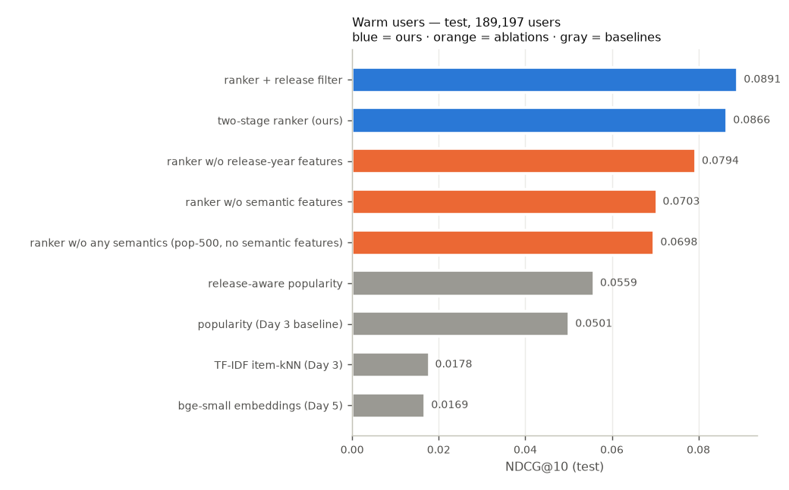
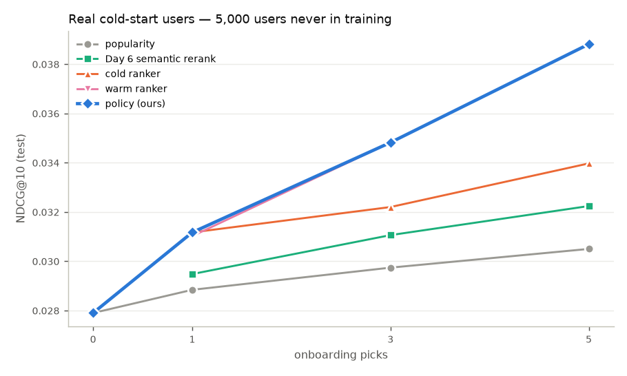
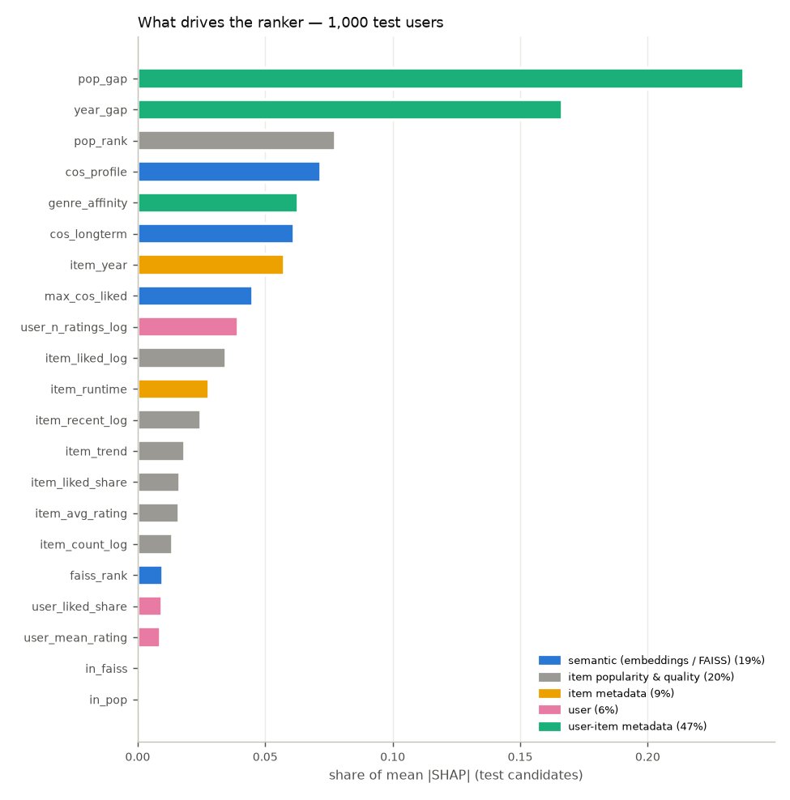

# Day 10 — Final test results

Split fingerprint `a99079d4a40a…`. Every setting was chosen on validation (Days 3–9); test is used once, here. Relevant = rating ≥ 4. Paired bootstrap = 2,000 resamples of users; `p_le_0` = share of resamples where the first model is not better.

## Warm users — test (189,197 users, history = train+val)

| model | ndcg@5 | ndcg@10 | ndcg@20 | recall@10 | precision@10 | mrr@10 | hit_rate@10 |
|---|---:|---:|---:|---:|---:|---:|---:|
| popularity (Day 3 baseline) | 0.0461 | 0.0501 | 0.0674 | 0.0548 | 0.0345 | 0.1013 | 0.2351 |
| release-aware popularity | 0.0502 | 0.0559 | 0.0744 | 0.0622 | 0.0384 | 0.1103 | 0.2585 |
| two-stage ranker (ours) | 0.0803 | 0.0866 | 0.1104 | 0.0936 | 0.0570 | 0.1713 | 0.3737 |
| ranker + release filter | 0.0823 | 0.0891 | 0.1138 | 0.0965 | 0.0587 | 0.1753 | 0.3822 |
| ranker w/o semantic features | 0.0626 | 0.0703 | 0.0926 | 0.0790 | 0.0481 | 0.1362 | 0.3238 |
| ranker w/o release-year features | 0.0741 | 0.0794 | 0.0999 | 0.0848 | 0.0520 | 0.1605 | 0.3492 |
| ranker w/o any semantics (pop-500, no semantic features) | 0.0624 | 0.0698 | 0.0916 | 0.0783 | 0.0478 | 0.1349 | 0.3208 |
| TF-IDF item-kNN (Day 3) | 0.0176 | 0.0178 | 0.0215 | 0.0181 | 0.0111 | 0.0410 | 0.0913 |
| bge-small embeddings (Day 5) | 0.0163 | 0.0169 | 0.0208 | 0.0175 | 0.0107 | 0.0388 | 0.0901 |

| model | coverage@10 | long_tail@10 | diversity@10 |
|---|---:|---:|---:|
| popularity (Day 3 baseline) | 0.0166 | 0.0000 | 0.7135 |
| release-aware popularity | 0.0180 | 0.0000 | 0.7165 |
| two-stage ranker (ours) | 0.2550 | 0.0220 | 0.6152 |
| ranker + release filter | 0.2569 | 0.0210 | 0.6206 |
| ranker w/o semantic features | 0.2616 | 0.0205 | 0.6139 |
| ranker w/o release-year features | 0.2312 | 0.0195 | 0.6042 |
| ranker w/o any semantics (pop-500, no semantic features) | 0.0396 | 0.0001 | 0.6169 |
| TF-IDF item-kNN (Day 3) | 0.6248 | 0.5922 | 0.5645 |
| bge-small embeddings (Day 5) | 0.9101 | 0.6375 | 0.4941 |

Paired bootstrap, NDCG@10:

| model | vs | change | 95% CI of diff | p_le_0 | significant |
|---|---|---:|---:|---:|---:|
| two-stage ranker (ours) | popularity (Day 3 baseline) | +72.7% | [+0.0358, +0.0371] | 0.0000 | yes |
| two-stage ranker (ours) | release-aware popularity | +55.0% | [+0.0301, +0.0314] | 0.0000 | yes |
| two-stage ranker (ours) | TF-IDF item-kNN (Day 3) | +387.5% | [+0.0682, +0.0695] | 0.0000 | yes |
| two-stage ranker (ours) | bge-small embeddings (Day 5) | +413.9% | [+0.0691, +0.0704] | 0.0000 | yes |
| two-stage ranker (ours) | ranker w/o semantic features | +23.1% | [+0.0157, +0.0168] | 0.0000 | yes |
| two-stage ranker (ours) | ranker w/o release-year features | +9.1% | [+0.0068, +0.0076] | 0.0000 | yes |
| two-stage ranker (ours) | ranker w/o any semantics (pop-500, no semantic features) | +24.1% | [+0.0163, +0.0173] | 0.0000 | yes |
| two-stage ranker (ours) | ranker + release filter | -2.8% | [-0.0025, -0.0024] | 1.0000 | no |
| release-aware popularity | popularity (Day 3 baseline) | +11.4% | [+0.0056, +0.0059] | 0.0000 | yes |
| ranker w/o semantic features | popularity (Day 3 baseline) | +40.3% | [+0.0197, +0.0208] | 0.0000 | yes |
| ranker w/o release-year features | popularity (Day 3 baseline) | +58.3% | [+0.0287, +0.0299] | 0.0000 | yes |
| ranker w/o any semantics (pop-500, no semantic features) | popularity (Day 3 baseline) | +39.2% | [+0.0191, +0.0203] | 0.0000 | yes |
| ranker w/o release-year features | release-aware popularity | +42.1% | [+0.0230, +0.0241] | 0.0000 | yes |

Ranker vs popularity on every metric:

| metric | change | 95% CI of diff | p_le_0 |
|---|---:|---:|---:|
| ndcg@5 | +74.1% | [+0.0335, +0.0349] | 0.0000 |
| ndcg@10 | +72.7% | [+0.0358, +0.0371] | 0.0000 |
| ndcg@20 | +63.8% | [+0.0423, +0.0437] | 0.0000 |
| recall@10 | +70.6% | [+0.0380, +0.0395] | 0.0000 |
| precision@10 | +65.2% | [+0.0221, +0.0229] | 0.0000 |
| mrr@10 | +69.0% | [+0.0685, +0.0714] | 0.0000 |
| hit_rate@10 | +58.9% | [+0.1363, +0.1407] | 0.0000 |

Release dates: 10.9% of popularity's top-10 slots are movies released after the user's last training rating; 0.6% of relevant test movies are such movies (the most a release filter can cost).

Serving cost (batch path, CPU): stage 1 + features 3.7 ms/user, LightGBM 2.2 ms/user — batches of 500 users, CPU; varies run to run.

## Ablations — validation (5,000 ranker-valid users; retrained on the same 15,000 users, same config)

| model | candidates | features | ndcg@10 | recall@10 | mrr@10 |
|---|---|---:|---:|---:|---:|
| popularity (Day 3 baseline) | popular 400 ∪ FAISS 100 | 21 | 0.0485 | 0.0544 | 0.0942 |
| two-stage ranker (ours) | popular 400 ∪ FAISS 100 | 21 | 0.0909 | 0.1001 | 0.1765 |
| ranker w/o semantic features | popular 400 ∪ FAISS 100 | 16 | 0.0753 | 0.0846 | 0.1425 |
| ranker w/o release-year features | popular 400 ∪ FAISS 100 | 19 | 0.0853 | 0.0914 | 0.1692 |
| ranker w/o any semantics (pop-500, no semantic features) | popular 500 | 16 | 0.0746 | 0.0846 | 0.1409 |

| model | vs | change | 95% CI of diff | p_le_0 | significant |
|---|---|---:|---:|---:|---:|
| two-stage ranker (ours) | ranker w/o semantic features | +20.7% | [+0.0125, +0.0187] | 0.0000 | yes |
| two-stage ranker (ours) | ranker w/o any semantics (pop-500, no semantic features) | +21.9% | [+0.0130, +0.0195] | 0.0000 | yes |
| two-stage ranker (ours) | ranker w/o release-year features | +6.6% | [+0.0031, +0.0082] | 0.0000 | yes |
| ranker w/o semantic features | popularity (Day 3 baseline) | +55.2% | [+0.0233, +0.0304] | 0.0000 | yes |
| ranker w/o any semantics (pop-500, no semantic features) | popularity (Day 3 baseline) | +53.7% | [+0.0225, +0.0296] | 0.0000 | yes |
| ranker w/o release-year features | popularity (Day 3 baseline) | +75.8% | [+0.0329, +0.0405] | 0.0000 | yes |

## Real cold-start users — test (5,000 users never in training)

Policy (chosen on pseudo-cold validation, Day 9): 0 picks → popularity, fewer than 3 → cold ranker, otherwise the warm ranker.

NDCG@10:

| seeds | popularity | Day 6 semantic rerank | cold ranker | warm ranker | policy (ours) |
|---:|---:|---:|---:|---:|---:|
| 0 | 0.0279 |  |  |  | 0.0279 |
| 1 | 0.0288 | 0.0295 | 0.0312 | 0.0310 | 0.0312 |
| 3 | 0.0297 | 0.0311 | 0.0322 | 0.0348 | 0.0348 |
| 5 | 0.0305 | 0.0322 | 0.0340 | 0.0388 | 0.0388 |

| seeds | model | serves | ndcg@5 | ndcg@10 | ndcg@20 | recall@10 | precision@10 | mrr@10 | hit_rate@10 |
|---:|---|---|---:|---:|---:|---:|---:|---:|---:|
| 0 | popularity |  | 0.0247 | 0.0279 | 0.0414 | 0.0313 | 0.0210 | 0.0578 | 0.1590 |
| 0 | policy (ours) | popularity | 0.0247 | 0.0279 | 0.0414 | 0.0313 | 0.0210 | 0.0578 | 0.1590 |
| 1 | popularity |  | 0.0254 | 0.0288 | 0.0422 | 0.0321 | 0.0215 | 0.0603 | 0.1622 |
| 1 | Day 6 semantic rerank |  | 0.0242 | 0.0295 | 0.0420 | 0.0344 | 0.0226 | 0.0584 | 0.1668 |
| 1 | cold ranker |  | 0.0252 | 0.0312 | 0.0452 | 0.0374 | 0.0233 | 0.0618 | 0.1868 |
| 1 | warm ranker |  | 0.0264 | 0.0310 | 0.0436 | 0.0355 | 0.0226 | 0.0627 | 0.1716 |
| 1 | policy (ours) | cold ranker | 0.0252 | 0.0312 | 0.0452 | 0.0374 | 0.0233 | 0.0618 | 0.1868 |
| 3 | popularity |  | 0.0265 | 0.0297 | 0.0433 | 0.0330 | 0.0221 | 0.0619 | 0.1644 |
| 3 | Day 6 semantic rerank |  | 0.0268 | 0.0311 | 0.0437 | 0.0355 | 0.0235 | 0.0630 | 0.1736 |
| 3 | cold ranker |  | 0.0276 | 0.0322 | 0.0472 | 0.0376 | 0.0233 | 0.0661 | 0.1868 |
| 3 | warm ranker |  | 0.0302 | 0.0348 | 0.0490 | 0.0402 | 0.0255 | 0.0671 | 0.1842 |
| 3 | policy (ours) | warm ranker | 0.0302 | 0.0348 | 0.0490 | 0.0402 | 0.0255 | 0.0671 | 0.1842 |
| 5 | popularity |  | 0.0274 | 0.0305 | 0.0443 | 0.0337 | 0.0226 | 0.0636 | 0.1658 |
| 5 | Day 6 semantic rerank |  | 0.0278 | 0.0322 | 0.0448 | 0.0369 | 0.0244 | 0.0654 | 0.1780 |
| 5 | cold ranker |  | 0.0284 | 0.0340 | 0.0490 | 0.0399 | 0.0254 | 0.0681 | 0.1936 |
| 5 | warm ranker |  | 0.0333 | 0.0388 | 0.0536 | 0.0445 | 0.0280 | 0.0752 | 0.2002 |
| 5 | policy (ours) | warm ranker | 0.0333 | 0.0388 | 0.0536 | 0.0445 | 0.0280 | 0.0752 | 0.2002 |

| seeds | model | vs | change | 95% CI of diff | p_le_0 | significant |
|---:|---|---|---:|---:|---:|---:|
| 1 | cold ranker | popularity | +8.1% | [-0.0002, +0.0049] | 0.0340 | no |
| 1 | cold ranker | Day 6 semantic rerank | +5.7% | [-0.0007, +0.0043] | 0.0835 | no |
| 1 | warm ranker | popularity | +7.6% | [-0.0001, +0.0045] | 0.0275 | no |
| 1 | warm ranker | Day 6 semantic rerank | +5.2% | [-0.0005, +0.0037] | 0.0705 | no |
| 1 | warm ranker | cold ranker | -0.5% | [-0.0024, +0.0022] | 0.5460 | no |
| 1 | policy (ours) | popularity | +8.1% | [-0.0002, +0.0049] | 0.0340 | no |
| 1 | policy (ours) | Day 6 semantic rerank | +5.7% | [-0.0007, +0.0043] | 0.0835 | no |
| 1 | Day 6 semantic rerank | popularity | +2.2% | [-0.0011, +0.0024] | 0.2300 | no |
| 3 | cold ranker | popularity | +8.3% | [-0.0001, +0.0051] | 0.0305 | no |
| 3 | cold ranker | Day 6 semantic rerank | +3.6% | [-0.0013, +0.0037] | 0.1780 | no |
| 3 | warm ranker | popularity | +17.1% | [+0.0026, +0.0076] | 0.0000 | yes |
| 3 | warm ranker | Day 6 semantic rerank | +12.1% | [+0.0016, +0.0060] | 0.0010 | yes |
| 3 | warm ranker | cold ranker | +8.2% | [+0.0003, +0.0050] | 0.0145 | yes |
| 3 | policy (ours) | popularity | +17.1% | [+0.0026, +0.0076] | 0.0000 | yes |
| 3 | policy (ours) | Day 6 semantic rerank | +12.1% | [+0.0016, +0.0060] | 0.0010 | yes |
| 3 | Day 6 semantic rerank | popularity | +4.5% | [+0.0000, +0.0026] | 0.0240 | yes |
| 5 | cold ranker | popularity | +11.4% | [+0.0009, +0.0061] | 0.0060 | yes |
| 5 | cold ranker | Day 6 semantic rerank | +5.4% | [-0.0008, +0.0042] | 0.0840 | no |
| 5 | warm ranker | popularity | +27.2% | [+0.0057, +0.0111] | 0.0000 | yes |
| 5 | warm ranker | Day 6 semantic rerank | +20.4% | [+0.0043, +0.0090] | 0.0000 | yes |
| 5 | warm ranker | cold ranker | +14.2% | [+0.0024, +0.0072] | 0.0005 | yes |
| 5 | policy (ours) | popularity | +27.2% | [+0.0057, +0.0111] | 0.0000 | yes |
| 5 | policy (ours) | Day 6 semantic rerank | +20.4% | [+0.0043, +0.0090] | 0.0000 | yes |
| 5 | Day 6 semantic rerank | popularity | +5.7% | [+0.0005, +0.0031] | 0.0050 | yes |

Reproduces the Day 6 test numbers (popularity, semantic rerank): ✓

## SHAP — 1,000 test users, 492,781 candidate rows (LightGBM pred_contrib (exact TreeSHAP, raw lambdarank score); additivity error 9.6e-14)

By group (all candidates / the top-10 shown):

| group | share | share (top-10) |
|---|---:|---:|
| user-item metadata | 0.4671 | 0.3968 |
| item popularity & quality | 0.2015 | 0.2937 |
| semantic (embeddings / FAISS) | 0.1883 | 0.2135 |
| item metadata | 0.0856 | 0.0560 |
| user | 0.0577 | 0.0401 |

| feature | group | share | mean_abs_shap | mean_shap | gain_share_day9 |
|---|---|---:|---:|---:|---:|
| pop_gap | user-item metadata | 0.2377 | 0.5391 | 0.0684 | 0.1204 |
| year_gap | user-item metadata | 0.1664 | 0.3775 | -0.0036 | 0.1042 |
| pop_rank | item popularity & quality | 0.0774 | 0.1755 | -0.0063 | 0.0953 |
| cos_profile | semantic (embeddings / FAISS) | 0.0717 | 0.1628 | -0.0624 | 0.0851 |
| genre_affinity | user-item metadata | 0.0630 | 0.1429 | 0.0052 | 0.0377 |
| cos_longterm | semantic (embeddings / FAISS) | 0.0614 | 0.1393 | -0.0063 | 0.0879 |
| item_year | item metadata | 0.0576 | 0.1307 | 0.0140 | 0.0531 |
| max_cos_liked | semantic (embeddings / FAISS) | 0.0450 | 0.1020 | -0.0060 | 0.0776 |
| user_n_ratings_log | user | 0.0394 | 0.0894 | -0.0106 | 0.0628 |
| item_liked_log | item popularity & quality | 0.0346 | 0.0784 | 0.0064 | 0.0532 |
| item_runtime | item metadata | 0.0280 | 0.0634 | 0.0040 | 0.0258 |
| item_recent_log | item popularity & quality | 0.0248 | 0.0562 | -0.0073 | 0.0291 |
| item_trend | item popularity & quality | 0.0185 | 0.0418 | 0.0056 | 0.0379 |
| item_liked_share | item popularity & quality | 0.0164 | 0.0372 | -0.0024 | 0.0186 |
| item_avg_rating | item popularity & quality | 0.0162 | 0.0367 | -0.0014 | 0.0236 |
| item_count_log | item popularity & quality | 0.0136 | 0.0308 | 0.0030 | 0.0300 |
| faiss_rank | semantic (embeddings / FAISS) | 0.0100 | 0.0227 | 0.0099 | 0.0135 |
| user_liked_share | user | 0.0095 | 0.0216 | -0.0024 | 0.0225 |
| user_mean_rating | user | 0.0088 | 0.0199 | -0.0011 | 0.0216 |
| in_faiss | semantic (embeddings / FAISS) | 0.0002 | 0.0006 | 0.0003 | 0.0002 |
| in_pop | item popularity & quality | 0.0000 | 0.0000 | 0.0000 | 0.0000 |

**Example — user 1277** (14 ratings; recently liked: Dirty Dancing (1987); Cool Hand Luke (1967); Tomorrow Never Dies (1997); Glory (1989); Muriel's Wedding (1994))

| # | recommended | liked in test | top reasons (SHAP) |
|---:|---|---|---|
| 1 | The Shawshank Redemption (1994) | ✓ | pop_rank=0.0 (+0.72), pop_gap=2.544 (+0.59), item_liked_log=11.297 (+0.30) |
| 2 | Pulp Fiction (1994) |  | pop_rank=1.0 (+0.65), pop_gap=2.407 (+0.60), item_liked_log=11.161 (+0.26) |
| 3 | The Godfather (1972) | ✓ | pop_rank=11.0 (+0.84), item_liked_log=10.801 (+0.37), pop_gap=2.047 (+0.36) |
| 4 | The Silence of the Lambs (1991) |  | pop_rank=4.0 (+0.83), item_liked_log=11.064 (+0.49), year_gap=2.0 (+0.48) |
| 5 | Forrest Gump (1994) |  | pop_rank=3.0 (+0.66), pop_gap=2.329 (+0.57), item_liked_log=11.083 (+0.26) |

**Example — user 2763** (188 ratings; recently liked: Citizen X (1995); Army of Darkness (1993); Zero Effect (1998); Wall Street (1987); Rounders (1998))

| # | recommended | liked in test | top reasons (SHAP) |
|---:|---|---|---|
| 1 | Monsters, Inc. (2001) |  | pop_gap=0.794 (+0.75), pop_rank=14.0 (+0.50), cos_profile=0.304 (+0.39) |
| 2 | Taxi Driver (1976) |  | pop_gap=0.724 (+0.78), pop_rank=18.0 (+0.50), cos_longterm=0.363 (+0.27) |
| 3 | The Fifth Element (1997) | ✓ | pop_gap=0.624 (+0.72), pop_rank=21.0 (+0.44), year_gap=3.821 (+0.36) |
| 4 | The Usual Suspects (1995) |  | pop_gap=1.429 (+0.68), pop_rank=1.0 (+0.47), year_gap=1.821 (+0.41) |
| 5 | 12 Angry Men (1957) |  | max_cos_liked=0.815 (+0.96), pop_gap=0.308 (+0.40), item_year=1957.0 (+0.34) |

