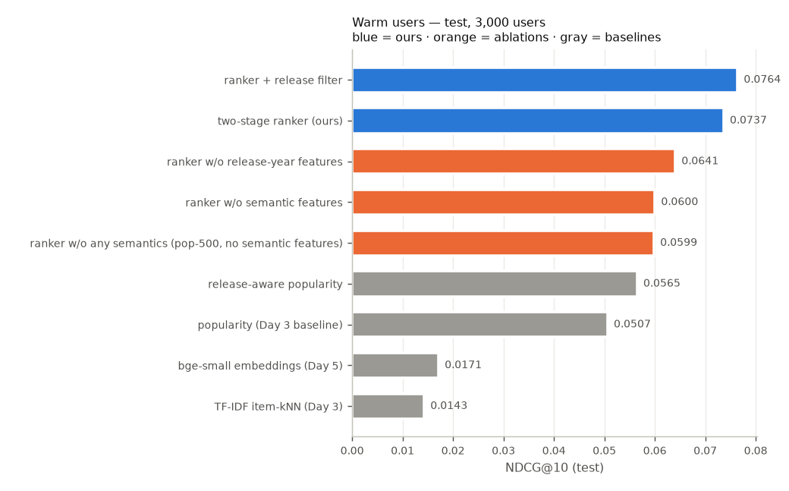
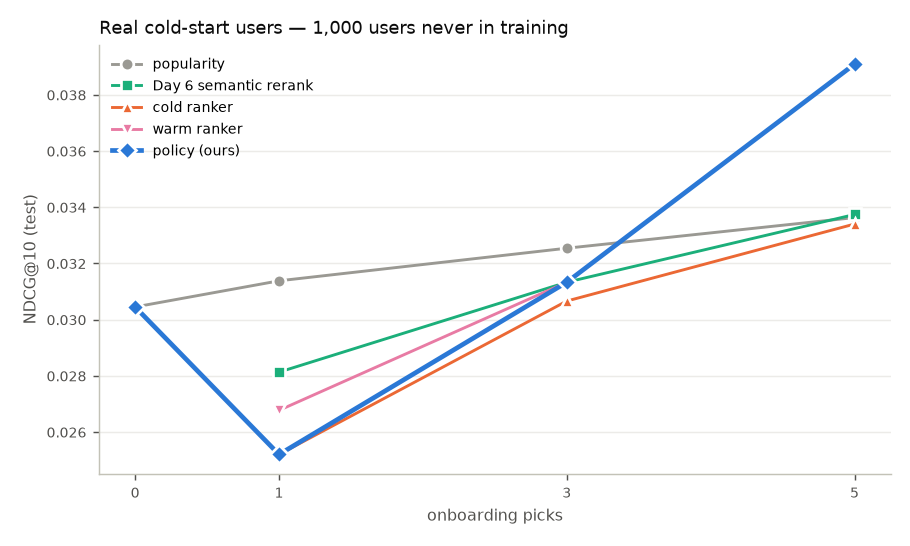
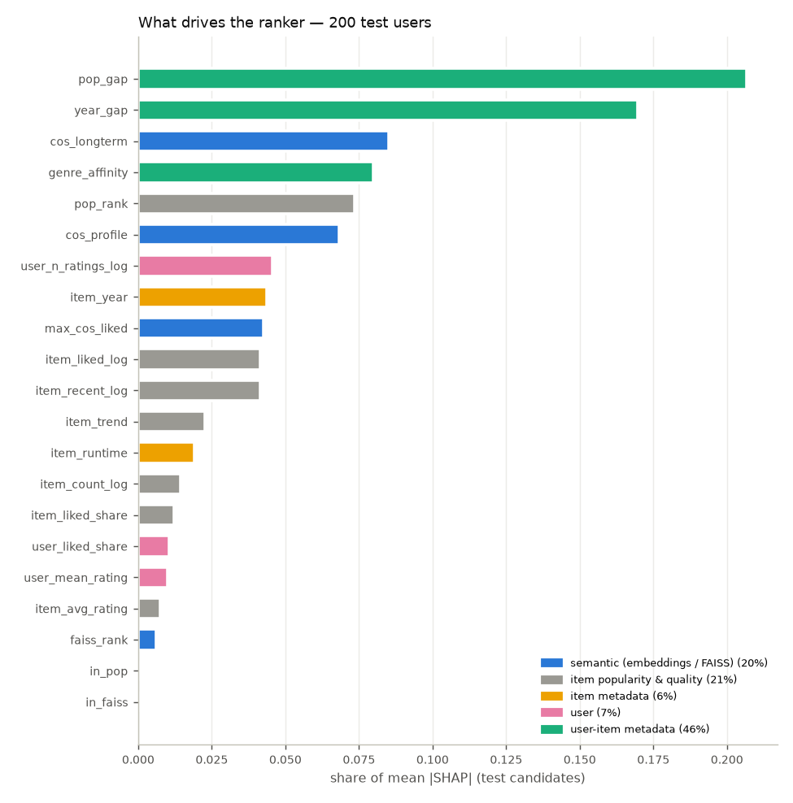

# Day 10 — Final test results

Split fingerprint `a99079d4a40a…`. Every setting was chosen on validation (Days 3–9); test is used once, here. Relevant = rating ≥ 4. Paired bootstrap = 2,000 resamples of users; `p_le_0` = share of resamples where the first model is not better.

## Warm users — test (3,000 users, history = train+val)

| model | ndcg@5 | ndcg@10 | ndcg@20 | recall@10 | precision@10 | mrr@10 | hit_rate@10 |
|---|---:|---:|---:|---:|---:|---:|---:|
| popularity (Day 3 baseline) | 0.0478 | 0.0507 | 0.0672 | 0.0543 | 0.0343 | 0.1030 | 0.2383 |
| release-aware popularity | 0.0520 | 0.0565 | 0.0752 | 0.0608 | 0.0382 | 0.1134 | 0.2583 |
| two-stage ranker (ours) | 0.0673 | 0.0737 | 0.0944 | 0.0797 | 0.0502 | 0.1456 | 0.3310 |
| ranker + release filter | 0.0696 | 0.0764 | 0.0977 | 0.0830 | 0.0521 | 0.1495 | 0.3400 |
| ranker w/o semantic features | 0.0523 | 0.0600 | 0.0787 | 0.0688 | 0.0424 | 0.1145 | 0.2940 |
| ranker w/o release-year features | 0.0590 | 0.0641 | 0.0844 | 0.0690 | 0.0437 | 0.1308 | 0.3007 |
| ranker w/o any semantics (pop-500, no semantic features) | 0.0526 | 0.0599 | 0.0789 | 0.0679 | 0.0417 | 0.1144 | 0.2853 |
| TF-IDF item-kNN (Day 3) | 0.0115 | 0.0143 | 0.0183 | 0.0162 | 0.0094 | 0.0323 | 0.0706 |
| bge-small embeddings (Day 5) | 0.0167 | 0.0171 | 0.0210 | 0.0182 | 0.0115 | 0.0391 | 0.0947 |

| model | coverage@10 | long_tail@10 | diversity@10 |
|---|---:|---:|---:|
| popularity (Day 3 baseline) | 0.0062 | 0.0000 | 0.7144 |
| release-aware popularity | 0.0066 | 0.0000 | 0.7172 |
| two-stage ranker (ours) | 0.0599 | 0.0177 | 0.6249 |
| ranker + release filter | 0.0605 | 0.0166 | 0.6306 |
| ranker w/o semantic features | 0.0565 | 0.0230 | 0.6300 |
| ranker w/o release-year features | 0.0482 | 0.0140 | 0.6216 |
| ranker w/o any semantics (pop-500, no semantic features) | 0.0193 | 0.0000 | 0.6462 |
| TF-IDF item-kNN (Day 3) |  |  |  |
| bge-small embeddings (Day 5) |  |  |  |

Paired bootstrap, NDCG@10:

| model | vs | change | 95% CI of diff | p_le_0 | significant |
|---|---|---:|---:|---:|---:|
| two-stage ranker (ours) | popularity (Day 3 baseline) | +45.4% | [+0.0182, +0.0276] | 0.0000 | yes |
| two-stage ranker (ours) | release-aware popularity | +30.4% | [+0.0126, +0.0216] | 0.0000 | yes |
| two-stage ranker (ours) | TF-IDF item-kNN (Day 3) | +469.4% | [+0.0407, +0.0980] | 0.0000 | yes |
| two-stage ranker (ours) | bge-small embeddings (Day 5) | +329.8% | [+0.0519, +0.0615] | 0.0000 | yes |
| two-stage ranker (ours) | ranker w/o semantic features | +22.7% | [+0.0099, +0.0175] | 0.0000 | yes |
| two-stage ranker (ours) | ranker w/o release-year features | +15.0% | [+0.0064, +0.0129] | 0.0000 | yes |
| two-stage ranker (ours) | ranker w/o any semantics (pop-500, no semantic features) | +23.1% | [+0.0099, +0.0179] | 0.0000 | yes |
| two-stage ranker (ours) | ranker + release filter | -3.6% | [-0.0034, -0.0021] | 1.0000 | no |
| release-aware popularity | popularity (Day 3 baseline) | +11.6% | [+0.0050, +0.0068] | 0.0000 | yes |
| ranker w/o semantic features | popularity (Day 3 baseline) | +18.5% | [+0.0051, +0.0136] | 0.0000 | yes |
| ranker w/o release-year features | popularity (Day 3 baseline) | +26.5% | [+0.0090, +0.0177] | 0.0000 | yes |
| ranker w/o any semantics (pop-500, no semantic features) | popularity (Day 3 baseline) | +18.2% | [+0.0045, +0.0138] | 0.0000 | yes |
| ranker w/o release-year features | release-aware popularity | +13.4% | [+0.0033, +0.0117] | 0.0010 | yes |

Ranker vs popularity on every metric:

| metric | change | 95% CI of diff | p_le_0 |
|---|---:|---:|---:|
| ndcg@5 | +40.9% | [+0.0141, +0.0249] | 0.0000 |
| ndcg@10 | +45.4% | [+0.0182, +0.0276] | 0.0000 |
| ndcg@20 | +40.5% | [+0.0226, +0.0317] | 0.0000 |
| recall@10 | +46.8% | [+0.0206, +0.0303] | 0.0000 |
| precision@10 | +46.1% | [+0.0130, +0.0187] | 0.0000 |
| mrr@10 | +41.3% | [+0.0319, +0.0531] | 0.0000 |
| hit_rate@10 | +38.9% | [+0.0750, +0.1087] | 0.0000 |

Release dates: 11.0% of popularity's top-10 slots are movies released after the user's last training rating; 0.7% of relevant test movies are such movies (the most a release filter can cost).

Serving cost (batch path, CPU): stage 1 + features 2.64 ms/user, LightGBM 0.74 ms/user — batches of 500 users, CPU; varies run to run.

## Ablations — validation (500 ranker-valid users; retrained on the same 1,500 users, same config)

| model | candidates | features | ndcg@10 | recall@10 | mrr@10 |
|---|---|---:|---:|---:|---:|
| popularity (Day 3 baseline) | popular 400 ∪ FAISS 100 | 21 | 0.0518 | 0.0587 | 0.0966 |
| two-stage ranker (ours) | popular 400 ∪ FAISS 100 | 21 | 0.0808 | 0.0962 | 0.1455 |
| ranker w/o semantic features | popular 400 ∪ FAISS 100 | 16 | 0.0663 | 0.0853 | 0.1171 |
| ranker w/o release-year features | popular 400 ∪ FAISS 100 | 19 | 0.0709 | 0.0785 | 0.1405 |
| ranker w/o any semantics (pop-500, no semantic features) | popular 500 | 16 | 0.0676 | 0.0867 | 0.1194 |

| model | vs | change | 95% CI of diff | p_le_0 | significant |
|---|---|---:|---:|---:|---:|
| two-stage ranker (ours) | ranker w/o semantic features | +22.0% | [+0.0051, +0.0251] | 0.0020 | yes |
| two-stage ranker (ours) | ranker w/o any semantics (pop-500, no semantic features) | +19.6% | [+0.0038, +0.0232] | 0.0025 | yes |
| two-stage ranker (ours) | ranker w/o release-year features | +13.9% | [+0.0016, +0.0188] | 0.0105 | yes |
| ranker w/o semantic features | popularity (Day 3 baseline) | +27.8% | [+0.0029, +0.0262] | 0.0040 | yes |
| ranker w/o any semantics (pop-500, no semantic features) | popularity (Day 3 baseline) | +30.4% | [+0.0045, +0.0273] | 0.0025 | yes |
| ranker w/o release-year features | popularity (Day 3 baseline) | +36.9% | [+0.0081, +0.0298] | 0.0020 | yes |

## Real cold-start users — test (1,000 users never in training)

Policy (chosen on pseudo-cold validation, Day 9): 0 picks → popularity, fewer than 3 → cold ranker, otherwise the warm ranker.

NDCG@10:

| seeds | popularity | Day 6 semantic rerank | cold ranker | warm ranker | policy (ours) |
|---:|---:|---:|---:|---:|---:|
| 0 | 0.0305 |  |  |  | 0.0305 |
| 1 | 0.0314 | 0.0281 | 0.0252 | 0.0268 | 0.0252 |
| 3 | 0.0325 | 0.0313 | 0.0307 | 0.0313 | 0.0313 |
| 5 | 0.0336 | 0.0337 | 0.0334 | 0.0391 | 0.0391 |

| seeds | model | serves | ndcg@5 | ndcg@10 | ndcg@20 | recall@10 | precision@10 | mrr@10 | hit_rate@10 |
|---:|---|---|---:|---:|---:|---:|---:|---:|---:|
| 0 | popularity |  | 0.0284 | 0.0305 | 0.0428 | 0.0326 | 0.0222 | 0.0666 | 0.1710 |
| 0 | policy (ours) | popularity | 0.0284 | 0.0305 | 0.0428 | 0.0326 | 0.0222 | 0.0666 | 0.1710 |
| 1 | popularity |  | 0.0294 | 0.0314 | 0.0437 | 0.0333 | 0.0227 | 0.0689 | 0.1730 |
| 1 | Day 6 semantic rerank |  | 0.0238 | 0.0281 | 0.0410 | 0.0322 | 0.0217 | 0.0569 | 0.1670 |
| 1 | cold ranker |  | 0.0212 | 0.0252 | 0.0373 | 0.0298 | 0.0202 | 0.0506 | 0.1570 |
| 1 | warm ranker |  | 0.0220 | 0.0268 | 0.0374 | 0.0313 | 0.0203 | 0.0536 | 0.1590 |
| 1 | policy (ours) | cold ranker | 0.0212 | 0.0252 | 0.0373 | 0.0298 | 0.0202 | 0.0506 | 0.1570 |
| 3 | popularity |  | 0.0304 | 0.0325 | 0.0448 | 0.0342 | 0.0234 | 0.0715 | 0.1740 |
| 3 | Day 6 semantic rerank |  | 0.0266 | 0.0313 | 0.0430 | 0.0356 | 0.0241 | 0.0647 | 0.1800 |
| 3 | cold ranker |  | 0.0255 | 0.0307 | 0.0431 | 0.0351 | 0.0222 | 0.0636 | 0.1700 |
| 3 | warm ranker |  | 0.0259 | 0.0313 | 0.0428 | 0.0351 | 0.0231 | 0.0630 | 0.1720 |
| 3 | policy (ours) | warm ranker | 0.0259 | 0.0313 | 0.0428 | 0.0351 | 0.0231 | 0.0630 | 0.1720 |
| 5 | popularity |  | 0.0314 | 0.0336 | 0.0459 | 0.0352 | 0.0241 | 0.0737 | 0.1760 |
| 5 | Day 6 semantic rerank |  | 0.0303 | 0.0337 | 0.0454 | 0.0367 | 0.0248 | 0.0724 | 0.1890 |
| 5 | cold ranker |  | 0.0301 | 0.0334 | 0.0463 | 0.0377 | 0.0250 | 0.0719 | 0.2030 |
| 5 | warm ranker |  | 0.0346 | 0.0391 | 0.0518 | 0.0427 | 0.0277 | 0.0825 | 0.2040 |
| 5 | policy (ours) | warm ranker | 0.0346 | 0.0391 | 0.0518 | 0.0427 | 0.0277 | 0.0825 | 0.2040 |

| seeds | model | vs | change | 95% CI of diff | p_le_0 | significant |
|---:|---|---|---:|---:|---:|---:|
| 1 | cold ranker | popularity | -19.7% | [-0.0116, -0.0011] | 0.9945 | no |
| 1 | cold ranker | Day 6 semantic rerank | -10.4% | [-0.0074, +0.0015] | 0.9055 | no |
| 1 | warm ranker | popularity | -14.7% | [-0.0097, +0.0005] | 0.9575 | no |
| 1 | warm ranker | Day 6 semantic rerank | -4.8% | [-0.0053, +0.0026] | 0.7435 | no |
| 1 | warm ranker | cold ranker | +6.3% | [-0.0024, +0.0058] | 0.2215 | no |
| 1 | policy (ours) | popularity | -19.7% | [-0.0116, -0.0011] | 0.9945 | no |
| 1 | policy (ours) | Day 6 semantic rerank | -10.4% | [-0.0074, +0.0015] | 0.9055 | no |
| 1 | Day 6 semantic rerank | popularity | -10.4% | [-0.0072, +0.0006] | 0.9580 | no |
| 3 | cold ranker | popularity | -5.8% | [-0.0075, +0.0034] | 0.7495 | no |
| 3 | cold ranker | Day 6 semantic rerank | -2.1% | [-0.0057, +0.0041] | 0.6090 | no |
| 3 | warm ranker | popularity | -3.7% | [-0.0068, +0.0044] | 0.6610 | no |
| 3 | warm ranker | Day 6 semantic rerank | -0.0% | [-0.0048, +0.0047] | 0.4945 | no |
| 3 | warm ranker | cold ranker | +2.2% | [-0.0040, +0.0056] | 0.3840 | no |
| 3 | policy (ours) | popularity | -3.7% | [-0.0068, +0.0044] | 0.6610 | no |
| 3 | policy (ours) | Day 6 semantic rerank | -0.0% | [-0.0048, +0.0047] | 0.4945 | no |
| 3 | Day 6 semantic rerank | popularity | -3.7% | [-0.0044, +0.0018] | 0.7950 | no |
| 5 | cold ranker | popularity | -0.7% | [-0.0066, +0.0056] | 0.5410 | no |
| 5 | cold ranker | Day 6 semantic rerank | -1.0% | [-0.0063, +0.0054] | 0.5520 | no |
| 5 | warm ranker | popularity | +16.2% | [-0.0007, +0.0117] | 0.0445 | no |
| 5 | warm ranker | Day 6 semantic rerank | +15.8% | [+0.0006, +0.0103] | 0.0140 | yes |
| 5 | warm ranker | cold ranker | +17.0% | [+0.0003, +0.0115] | 0.0180 | yes |
| 5 | policy (ours) | popularity | +16.2% | [-0.0007, +0.0117] | 0.0445 | no |
| 5 | policy (ours) | Day 6 semantic rerank | +15.8% | [+0.0006, +0.0103] | 0.0140 | yes |
| 5 | Day 6 semantic rerank | popularity | +0.3% | [-0.0033, +0.0034] | 0.4880 | no |

## SHAP — 200 test users, 98,464 candidate rows (LightGBM pred_contrib (exact TreeSHAP, raw lambdarank score); additivity error 6.2e-15)

By group (all candidates / the top-10 shown):

| group | share | share (top-10) |
|---|---:|---:|
| user-item metadata | 0.4561 | 0.3812 |
| item popularity & quality | 0.2131 | 0.3344 |
| semantic (embeddings / FAISS) | 0.2022 | 0.2076 |
| user | 0.0660 | 0.0370 |
| item metadata | 0.0626 | 0.0398 |

| feature | group | share | mean_abs_shap | mean_shap | gain_share_day9 |
|---|---|---:|---:|---:|---:|
| pop_gap | user-item metadata | 0.2067 | 0.3964 | 0.0570 | 0.1104 |
| year_gap | user-item metadata | 0.1696 | 0.3253 | -0.0001 | 0.1042 |
| cos_longterm | semantic (embeddings / FAISS) | 0.0851 | 0.1633 | -0.0361 | 0.1072 |
| genre_affinity | user-item metadata | 0.0798 | 0.1530 | 0.0080 | 0.0493 |
| pop_rank | item popularity & quality | 0.0736 | 0.1412 | 0.0067 | 0.0986 |
| cos_profile | semantic (embeddings / FAISS) | 0.0683 | 0.1310 | -0.0376 | 0.0910 |
| user_n_ratings_log | user | 0.0456 | 0.0874 | -0.0057 | 0.0563 |
| item_year | item metadata | 0.0436 | 0.0836 | 0.0135 | 0.0472 |
| max_cos_liked | semantic (embeddings / FAISS) | 0.0427 | 0.0819 | 0.0014 | 0.0643 |
| item_liked_log | item popularity & quality | 0.0414 | 0.0794 | 0.0241 | 0.0455 |
| item_recent_log | item popularity & quality | 0.0414 | 0.0794 | -0.0052 | 0.0380 |
| item_trend | item popularity & quality | 0.0226 | 0.0434 | 0.0060 | 0.0444 |
| item_runtime | item metadata | 0.0190 | 0.0364 | 0.0027 | 0.0252 |
| item_count_log | item popularity & quality | 0.0143 | 0.0274 | 0.0074 | 0.0254 |
| item_liked_share | item popularity & quality | 0.0123 | 0.0236 | -0.0081 | 0.0138 |
| user_liked_share | user | 0.0104 | 0.0200 | 0.0004 | 0.0267 |
| user_mean_rating | user | 0.0100 | 0.0191 | 0.0011 | 0.0212 |
| item_avg_rating | item popularity & quality | 0.0075 | 0.0144 | 0.0031 | 0.0157 |
| faiss_rank | semantic (embeddings / FAISS) | 0.0061 | 0.0117 | -0.0020 | 0.0156 |
| in_pop | item popularity & quality | 0.0000 | 0.0000 | 0.0000 | 0.0000 |
| in_faiss | semantic (embeddings / FAISS) | 0.0000 | 0.0000 | 0.0000 | 0.0000 |

**Example — user 5940** (56 ratings; recently liked: Star Wars: Episode V - The Empire Strikes Back (1980); Rush Hour (1998); James and the Giant Peach (1996); The Lion King (1994); Mulan (1998))

| # | recommended | liked in test | top reasons (SHAP) |
|---:|---|---|---|
| 1 | Star Wars: Episode VI - Return of the Jedi (1983) | ✓ | max_cos_liked=0.675 (+0.74), pop_gap=2.016 (+0.53), pop_rank=14.0 (+0.47) |
| 2 | Star Wars: Episode IV - A New Hope (1977) |  | pop_gap=2.314 (+0.58), pop_rank=4.0 (+0.57), max_cos_liked=0.621 (+0.57) |
| 3 | Back to the Future (1985) |  | year_gap=1.407 (+0.55), pop_rank=20.0 (+0.51), pop_gap=1.903 (+0.46) |
| 4 | Robin Hood (1973) |  | pop_gap=-0.516 (+0.67), cos_profile=0.373 (+0.34), cos_longterm=0.391 (+0.29) |
| 5 | Willy Wonka & the Chocolate Factory (1971) |  | pop_gap=1.044 (+0.66), item_year=1971.0 (+0.47), cos_longterm=0.28 (+0.28) |

**Example — user 14539** (18 ratings; recently liked: The Avengers (2012); Toy Story 3 (2010); Monty Python and the Holy Grail (1975); Toy Story (1995); Saving Private Ryan (1998))

| # | recommended | liked in test | top reasons (SHAP) |
|---:|---|---|---|
| 1 | Toy Story 2 (1999) |  | pop_gap=-0.494 (+0.57), cos_profile=0.607 (+0.56), max_cos_liked=0.701 (+0.51) |
| 2 | Monsters, Inc. (2001) |  | year_gap=0.267 (+0.81), pop_gap=-0.123 (+0.51), pop_rank=44.0 (+0.37) |
| 3 | Gladiator (2000) | ✓ | year_gap=0.733 (+0.64), pop_rank=21.0 (+0.60), pop_gap=0.184 (+0.54) |
| 4 | Shrek (2001) |  | year_gap=0.267 (+0.62), pop_gap=-0.008 (+0.58), pop_rank=32.0 (+0.33) |
| 5 | Star Wars: Episode V - The Empire Strikes Back (1980) |  | max_cos_liked=0.675 (+0.78), pop_rank=7.0 (+0.59), pop_gap=0.549 (+0.50) |

