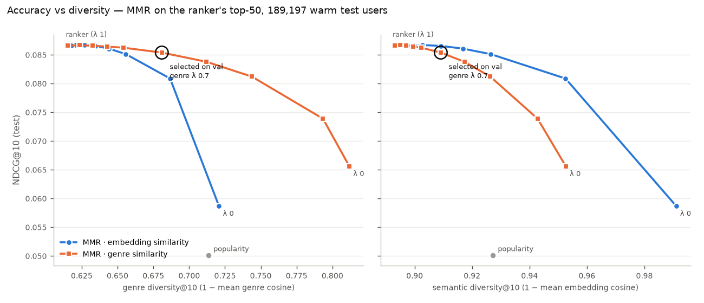

# Day 11 — Diversity re-ranking (MMR) + explanations

Split fingerprint `a99079d4a40a…`. MMR re-ranks the ranker's top-50: next = argmax λ·rel − (1−λ)·max sim to the movies already picked (rel = ranker score min-max scaled per user). λ 1 = the ranker. Genre diversity = 1 − mean pairwise cosine of genre vectors in the top-10 (the Day 3 metric); semantic diversity = the same with the mean-centered bge vectors.

## Choice on validation (5,000 Day 9 ranker-valid users)

Rule (written before the run): per space, the λ with the largest average diversity gain (genre + semantic) whose NDCG@10 is within 2% of the ranker; then the space with the larger gain. **Selected: genre similarity, λ 0.7.**

| model | lambda | ndcg@10 | recall@10 | coverage@10 | long_tail@10 | genre_div@10 | sem_div@10 | genres@10 | div_gain |
|---|---:|---:|---:|---:|---:|---:|---:|---:|---:|
| popularity |  | 0.0485 | 0.0544 | 0.0080 | 0.0000 | 0.7089 | 0.9259 | 10.8760 |  |
| ranker (λ 1) | 1.0000 | 0.0909 | 0.1001 | 0.0852 | 0.0245 | 0.6201 | 0.8949 | 10.2740 | 0.0000 |
| MMR · embedding similarity | 0.9500 | 0.0909 | 0.1002 | 0.0847 | 0.0240 | 0.6222 | 0.8967 | 10.3120 | 0.0027 |
| MMR · embedding similarity | 0.9000 | 0.0909 | 0.1005 | 0.0847 | 0.0237 | 0.6244 | 0.8990 | 10.3590 | 0.0057 |
| MMR · embedding similarity | 0.8500 | 0.0907 | 0.1001 | 0.0842 | 0.0234 | 0.6268 | 0.9014 | 10.4040 | 0.0090 |
| MMR · embedding similarity | 0.8000 | 0.0903 | 0.0994 | 0.0843 | 0.0233 | 0.6303 | 0.9044 | 10.4610 | 0.0135 |
| MMR · embedding similarity | 0.7000 | 0.0896 | 0.0984 | 0.0838 | 0.0229 | 0.6375 | 0.9103 | 10.5760 | 0.0226 |
| MMR · embedding similarity | 0.6000 | 0.0889 | 0.0978 | 0.0830 | 0.0217 | 0.6472 | 0.9181 | 10.7220 | 0.0348 |
| MMR · embedding similarity | 0.5000 | 0.0874 | 0.0959 | 0.0816 | 0.0202 | 0.6592 | 0.9280 | 10.9260 | 0.0500 |
| MMR · embedding similarity | 0.3000 | 0.0826 | 0.0897 | 0.0751 | 0.0154 | 0.6886 | 0.9543 | 11.4490 | 0.0884 |
| MMR · embedding similarity | 0.0000 | 0.0590 | 0.0584 | 0.0691 | 0.0104 | 0.7191 | 0.9926 | 12.1450 | 0.1344 |
| ranker (λ 1) | 1.0000 | 0.0909 | 0.1001 | 0.0852 | 0.0245 | 0.6201 | 0.8949 | 10.2740 | 0.0000 |
| MMR · genre similarity | 0.9500 | 0.0907 | 0.0997 | 0.0849 | 0.0244 | 0.6283 | 0.8966 | 10.4400 | 0.0075 |
| MMR · genre similarity | 0.9000 | 0.0903 | 0.0992 | 0.0843 | 0.0241 | 0.6373 | 0.8988 | 10.6280 | 0.0160 |
| MMR · genre similarity | 0.8500 | 0.0901 | 0.0992 | 0.0839 | 0.0239 | 0.6472 | 0.9012 | 10.8240 | 0.0254 |
| MMR · genre similarity | 0.8000 | 0.0903 | 0.0996 | 0.0836 | 0.0239 | 0.6583 | 0.9040 | 11.0340 | 0.0359 |
| MMR · genre similarity | 0.7000 | 0.0892 | 0.0981 | 0.0824 | 0.0232 | 0.6845 | 0.9105 | 11.5240 | 0.0606 |
| MMR · genre similarity | 0.6000 | 0.0881 | 0.0974 | 0.0809 | 0.0219 | 0.7157 | 0.9192 | 12.1300 | 0.0906 |
| MMR · genre similarity | 0.5000 | 0.0853 | 0.0948 | 0.0790 | 0.0202 | 0.7469 | 0.9282 | 12.7370 | 0.1208 |
| MMR · genre similarity | 0.3000 | 0.0772 | 0.0831 | 0.0741 | 0.0173 | 0.7956 | 0.9448 | 13.7590 | 0.1694 |
| MMR · genre similarity | 0.0000 | 0.0680 | 0.0691 | 0.0713 | 0.0158 | 0.8135 | 0.9540 | 14.3220 | 0.1889 |

## Test (189,197 warm users, history = train+val)

Key rows:

| model | lambda | ndcg@5 | ndcg@10 | ndcg@20 | recall@10 | mrr@10 | hit_rate@10 |
|---|---:|---:|---:|---:|---:|---:|---:|
| popularity |  | 0.0461 | 0.0501 | 0.0674 | 0.0548 | 0.1013 | 0.2351 |
| ranker (λ 1) | 1.0000 | 0.0803 | 0.0866 | 0.1104 | 0.0936 | 0.1713 | 0.3737 |
| MMR · embedding similarity | 0.7000 | 0.0801 | 0.0866 | 0.1105 | 0.0937 | 0.1721 | 0.3762 |
| MMR · genre similarity | 0.7000 | 0.0784 | 0.0854 | 0.1092 | 0.0926 | 0.1704 | 0.3731 |

| model | lambda | coverage@10 | long_tail@10 | genre_div@10 | sem_div@10 | genres@10 |
|---|---:|---:|---:|---:|---:|---:|
| popularity |  | 0.0166 | 0.0000 | 0.7135 | 0.9273 | 10.9440 |
| ranker (λ 1) | 1.0000 | 0.2550 | 0.0220 | 0.6152 | 0.8930 | 10.2000 |
| MMR · embedding similarity | 0.7000 | 0.2518 | 0.0202 | 0.6344 | 0.9091 | 10.5130 |
| MMR · genre similarity | 0.7000 | 0.2486 | 0.0202 | 0.6809 | 0.9091 | 11.4940 |

Paired bootstrap vs the ranker (2,000 resamples of users; `ild` = per-user diversity, `n_genres` = distinct genres in the top-10):

| model | metric | change | diff | 95% CI of diff | p_le_0 |
|---|---|---:|---:|---:|---:|
| MMR · genre similarity, λ 0.7 | ndcg@10 | -1.4% | -0.0012 | [-0.0014, -0.0011] | 1.0000 |
| MMR · genre similarity, λ 0.7 | recall@10 | -1.1% | -0.0010 | [-0.0013, -0.0007] | 1.0000 |
| MMR · genre similarity, λ 0.7 | mrr@10 | -0.5% | -0.0009 | [-0.0012, -0.0007] | 1.0000 |
| MMR · genre similarity, λ 0.7 | genre_ild | +10.7% | 0.0657 | [+0.0654, +0.0659] | 0.0000 |
| MMR · genre similarity, λ 0.7 | sem_ild | +1.8% | 0.0161 | [+0.0160, +0.0162] | 0.0000 |
| MMR · genre similarity, λ 0.7 | n_genres | +12.7% | 1.2944 | [+1.2879, +1.3010] | 0.0000 |
| MMR · embedding similarity, λ 0.7 | ndcg@10 | -0.0% | -0.0000 | [-0.0002, +0.0001] | 0.7705 |
| MMR · embedding similarity, λ 0.7 | recall@10 | +0.1% | 0.0001 | [-0.0001, +0.0003] | 0.1525 |
| MMR · embedding similarity, λ 0.7 | mrr@10 | +0.5% | 0.0008 | [+0.0006, +0.0010] | 0.0000 |
| MMR · embedding similarity, λ 0.7 | genre_ild | +3.1% | 0.0192 | [+0.0190, +0.0194] | 0.0000 |
| MMR · embedding similarity, λ 0.7 | sem_ild | +1.8% | 0.0160 | [+0.0159, +0.0161] | 0.0000 |
| MMR · embedding similarity, λ 0.7 | n_genres | +3.1% | 0.3131 | [+0.3088, +0.3173] | 0.0000 |

Check: λ 1 = the Day 10 ranker (0.0866): ✓

Cost: MMR for all 20 settings 1.458 ms/user on top of 3.88 ms/user for stage 1 + features + ranker (batches of 500 users, CPU; varies run to run).

Full λ grid (test)

| model | lambda | ndcg@10 | recall@10 | coverage@10 | long_tail@10 | genre_div@10 | sem_div@10 | genres@10 |
|---|---:|---:|---:|---:|---:|---:|---:|---:|
| popularity |  | 0.0501 | 0.0548 | 0.0166 | 0.0000 | 0.7135 | 0.9273 | 10.9440 |
| ranker (λ 1) | 1.0000 | 0.0866 | 0.0936 | 0.2550 | 0.0220 | 0.6152 | 0.8930 | 10.2000 |
| MMR · embedding similarity | 0.9500 | 0.0867 | 0.0936 | 0.2549 | 0.0217 | 0.6177 | 0.8952 | 10.2420 |
| MMR · embedding similarity | 0.9000 | 0.0867 | 0.0937 | 0.2540 | 0.0215 | 0.6206 | 0.8975 | 10.2870 |
| MMR · embedding similarity | 0.8500 | 0.0867 | 0.0937 | 0.2536 | 0.0212 | 0.6235 | 0.9000 | 10.3360 |
| MMR · embedding similarity | 0.8000 | 0.0867 | 0.0938 | 0.2533 | 0.0209 | 0.6268 | 0.9027 | 10.3890 |
| MMR · embedding similarity | 0.7000 | 0.0866 | 0.0937 | 0.2518 | 0.0202 | 0.6344 | 0.9091 | 10.5130 |
| MMR · embedding similarity | 0.6000 | 0.0861 | 0.0932 | 0.2501 | 0.0193 | 0.6440 | 0.9168 | 10.6670 |
| MMR · embedding similarity | 0.5000 | 0.0851 | 0.0923 | 0.2485 | 0.0181 | 0.6558 | 0.9265 | 10.8590 |
| MMR · embedding similarity | 0.3000 | 0.0809 | 0.0872 | 0.2385 | 0.0143 | 0.6867 | 0.9525 | 11.3920 |
| MMR · embedding similarity | 0.0000 | 0.0587 | 0.0584 | 0.2490 | 0.0094 | 0.7208 | 0.9910 | 12.1010 |
| ranker (λ 1) | 1.0000 | 0.0866 | 0.0936 | 0.2550 | 0.0220 | 0.6152 | 0.8930 | 10.2000 |
| MMR · genre similarity | 0.9500 | 0.0867 | 0.0937 | 0.2547 | 0.0217 | 0.6234 | 0.8950 | 10.3690 |
| MMR · genre similarity | 0.9000 | 0.0866 | 0.0936 | 0.2534 | 0.0215 | 0.6325 | 0.8971 | 10.5540 |
| MMR · genre similarity | 0.8500 | 0.0864 | 0.0935 | 0.2520 | 0.0212 | 0.6427 | 0.8995 | 10.7580 |
| MMR · genre similarity | 0.8000 | 0.0862 | 0.0934 | 0.2512 | 0.0209 | 0.6542 | 0.9024 | 10.9820 |
| MMR · genre similarity | 0.7000 | 0.0854 | 0.0926 | 0.2486 | 0.0202 | 0.6809 | 0.9091 | 11.4940 |
| MMR · genre similarity | 0.6000 | 0.0838 | 0.0909 | 0.2469 | 0.0193 | 0.7121 | 0.9173 | 12.0730 |
| MMR · genre similarity | 0.5000 | 0.0812 | 0.0881 | 0.2438 | 0.0181 | 0.7438 | 0.9263 | 12.6630 |
| MMR · genre similarity | 0.3000 | 0.0739 | 0.0784 | 0.2357 | 0.0158 | 0.7934 | 0.9428 | 13.6690 |
| MMR · genre similarity | 0.0000 | 0.0656 | 0.0657 | 0.2355 | 0.0142 | 0.8118 | 0.9526 | 14.2590 |

## Explanations (500 test users, 5,000 served recommendations, MMR genre λ 0.7)

| reason | share of recs | share of hits |
|---|---:|---:|
| popular | 0.7456 | 0.7695 |
| similar | 0.1602 | 0.1454 |
| era | 0.0938 | 0.0851 |
| genre | 0.0004 | 0.0000 |

A cited movie ("Because you liked X", cos ≥ 0.3) is available for 54% of recommendations. Best-cosine quantiles: p10 0.188, p25 0.242, p50 0.312, p75 0.406, p90 0.615. Distinct cited movies per top-10: ranker 4.29, MMR 4.36.

**Faithfulness** (2,679 recommendations; stage 1 fixed; all stage-2 features recomputed from the history without that movie):

| remove from history | mean score drop | score went down | mean rank change | left the top-10 |
|---|---:|---:|---:|---:|
| the cited movie X | 0.4858 | 89% | +25.7 | 48% |
| a random other recent like | 0.0182 | 40% | +0.6 | 7% |

Cited − control score drop: +0.4676, 95% CI [+0.4467, +0.4897].

Serving cost per user: MMR 0.187 ms, explanations (TreeSHAP on 10 rows + cited movie) 19.6 ms (on top of stage 1 + features + ranker; CPU, varies). Worked examples: `day11_examples.md`.
